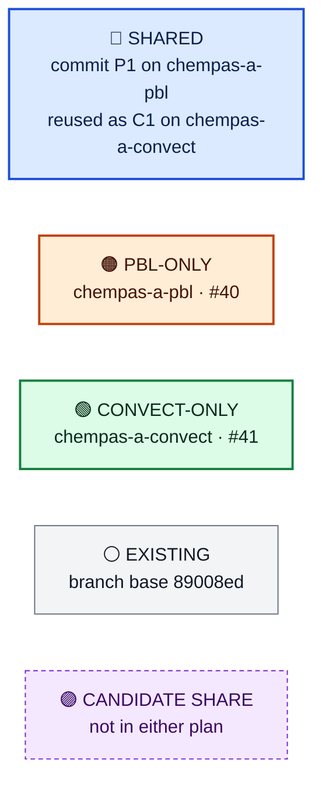
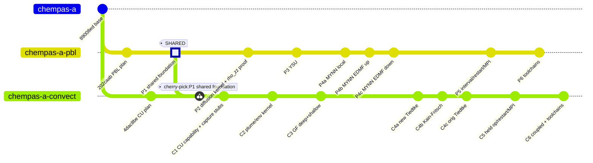
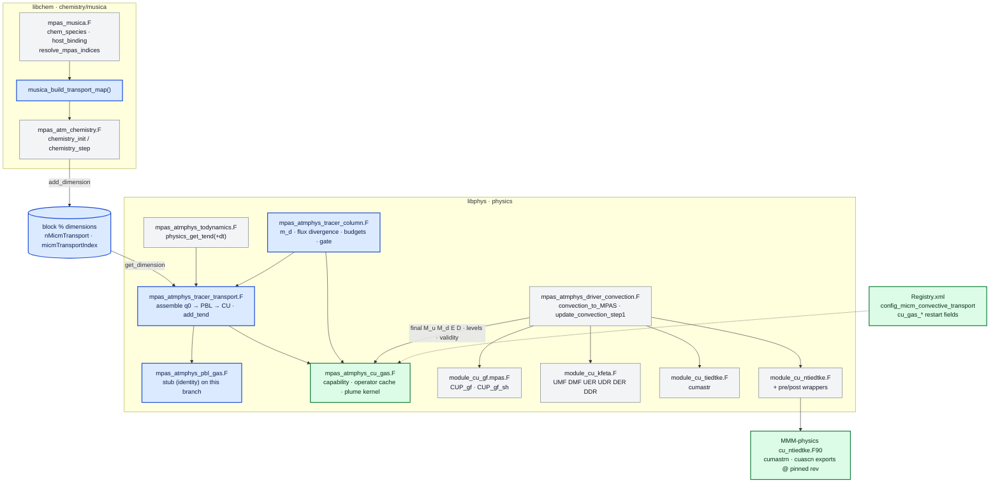
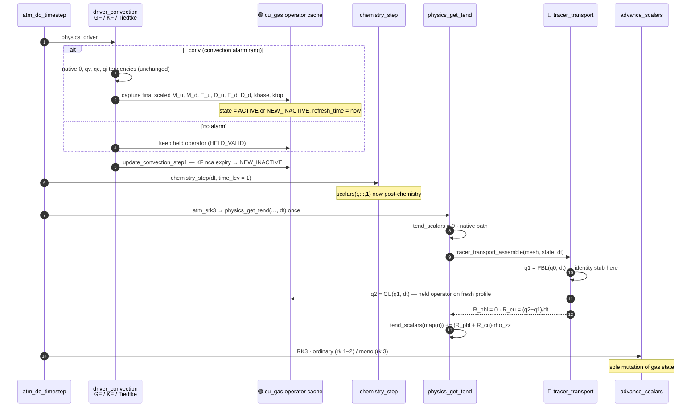
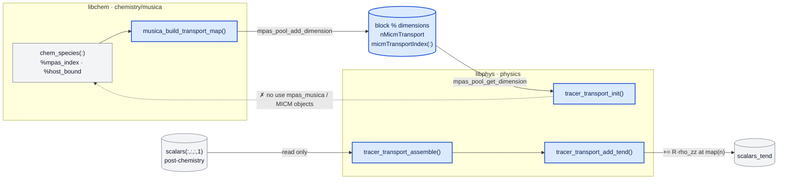
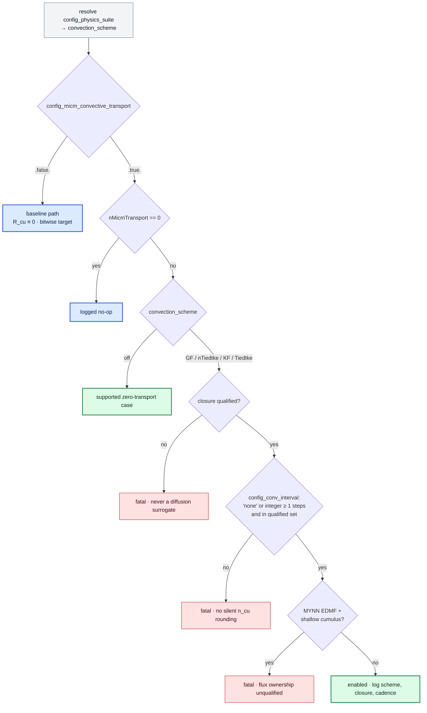
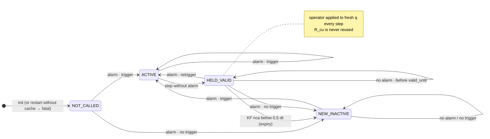
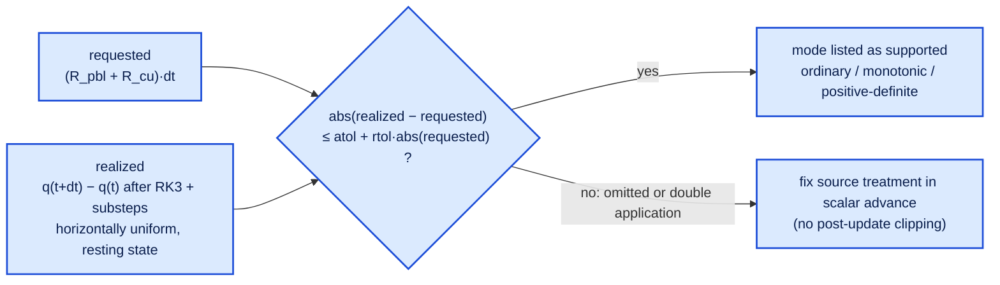

# Convective transport of MICM tracers — code & diagrams

[Plan](convective-transport.md) · branch `chempas-a-convect` · [CheMPAS-A #41](https://github.com/NCAR/CheMPAS-A/issues/41) · companion: [pbl-transport-code.md](https://github.com/NCAR/CheMPAS-A/blob/chempas-a-pbl/docs/plans/pbl-transport-code.md)

## 1 · Legend



## 2 · Commit graph 🔵 (identical in both files)



## 3 · Module map (chempas-a-convect)



## 4 · One model step (chempas-a-convect)



## 5 · 🔵 SHARED foundation — commit P1 → reused as C1

> Every block in §5 is byte-identical in `pbl-transport-code.md` and `convective-transport-code.md`.

### 5.1 🔵 Shared file layout

```text
src/core_atmosphere/
├── chemistry/musica/
│   ├── mpas_musica.F                     🔵 + musica_build_transport_map()
│   └── mpas_atm_chemistry.F              🔵 chemistry_init: publish map to block % dimensions
├── physics/
│   ├── mpas_atmphys_tracer_column.F      🔵 NEW  units, dry mass, flux divergence, budgets, capability gate, cache meta
│   ├── mpas_atmphys_tracer_transport.F   🔵 NEW  map, buffers, assemble (PBL→CU), add_tend, lifecycle
│   ├── mpas_atmphys_pbl_gas.F            🔵 NEW  stub   ──► 🟠 body replaced on chempas-a-pbl
│   ├── mpas_atmphys_cu_gas.F             🔵 NEW  stub   ──► 🟢 body replaced on chempas-a-convect
│   ├── mpas_atmphys_todynamics.F         🔵 physics_get_tend(+dt): call assemble + add_tend
│   └── Makefile                          🔵 objects + dependencies
├── dynamics/mpas_atm_time_integration.F  🔵 atm_srk3: pass dt to physics_get_tend
└── mpas_atm_core.F                       🔵 init after chemistry_init, finalize
testing/chemistry_transport/              🔵 shared fixture/checker layout (§7)
```

### 5.2 🔵 Runtime species map — chemistry side

```fortran
! 🔵 SHARED · P1 — src/core_atmosphere/chemistry/musica/mpas_musica.F  (proposed)
    !------------------------------------------------------------------------
    !  subroutine musica_build_transport_map
    !
    !> \brief Compact list of MPAS scalar indices for independently transported MICM gases
    !------------------------------------------------------------------------
    subroutine musica_build_transport_map(num_scalars, native_index, transport_to_scalar, &
                                          error_code, error_message)

        use mpas_log, only: mpas_log_write

        integer, intent(in)  :: num_scalars
        integer, intent(in)  :: native_index(:)        ! index_qv, index_qc, ... (0 = absent)
        integer, allocatable, intent(out) :: transport_to_scalar(:)
        integer, intent(out) :: error_code
        character(len=:), allocatable, intent(out) :: error_message

        integer :: i_sp, n, idx
        logical, allocatable :: claimed(:)

        error_code = 0
        error_message = ''
        allocate(transport_to_scalar(n_chem_species))
        allocate(claimed(num_scalars))
        claimed(:) = .false.
        n = 0

        do i_sp = 1, n_chem_species
            idx = chem_species(i_sp)%mpas_index

            ! H2O -> qv, and O2/N2 anchored on qv, are not independent gases
            if (chem_species(i_sp)%host_bound .or. .not. chem_species(i_sp)%write_back) then
                call mpas_log_write('[MUSICA] transport: exclude ' // trim(chem_species(i_sp)%micm_name) // &
                                    ' (host-bound to ' // trim(chem_species(i_sp)%mpas_name) // ')')
                cycle
            end if

            if (idx < 1 .or. idx > num_scalars) then
                error_code = 1
                error_message = '[MUSICA] transport: scalar index out of range for ' // &
                                trim(chem_species(i_sp)%mpas_name)
                return
            end if
            if (any(native_index == idx)) then
                error_code = 1
                error_message = '[MUSICA] transport: ' // trim(chem_species(i_sp)%mpas_name) // &
                                ' collides with a native MPAS scalar'
                return
            end if
            if (claimed(idx)) then
                error_code = 1
                error_message = '[MUSICA] transport: duplicate scalar index for ' // &
                                trim(chem_species(i_sp)%mpas_name)
                return
            end if

            ! no filtering by name, order, contiguity, initial value, or lifetime
            claimed(idx) = .true.
            n = n + 1
            transport_to_scalar(n) = idx
            call mpas_log_write('[MUSICA] transport: ' // trim(chem_species(i_sp)%micm_name) // &
                                ' -> scalars($i)', intArgs=[idx])
        end do

        transport_to_scalar = transport_to_scalar(1:n)   ! n == 0 is a valid no-op

    end subroutine musica_build_transport_map
```

```fortran
! 🔵 SHARED · P1 — src/core_atmosphere/chemistry/musica/mpas_atm_chemistry.F :: chemistry_init
        ! Resolve MPAS tracer indices for all chemistry species
        nullify(statePool)
        call mpas_pool_get_subpool(structs, 'state', statePool)
        if (associated(statePool)) then
            call resolve_mpas_indices(statePool, error_code, error_message)
            if (error_code /= 0) then
                call chem_fatal(error_message)
            end if

            ! >>> new: block-owned transport map, consumed by physics without importing mpas_musica
            if (associated(blocklist % next)) then
                call chem_fatal('[MUSICA] transport map requires one block per rank')
            end if
            call musica_build_transport_map(num_scalars, native_scalar_indices(statePool), &
                                            transport_to_scalar, error_code, error_message)
            if (error_code /= 0) then
                call chem_fatal(error_message)
            end if
            call mpas_pool_add_dimension(blocklist % dimensions, 'nMicmTransport', size(transport_to_scalar))
            call mpas_pool_add_dimension(blocklist % dimensions, 'micmTransportIndex', transport_to_scalar)
            ! <<<
```

### 5.3 🔵 Column units, dry mass, flux divergence, budgets

```text
🔵 SHARED · P1 — closed column, MPAS k = 1 at the ground

            F(nz+1) = 0                 ← model top: closed
  ┌───────────────────────────┐
  │ layer nz   m_d(nz) q(nz)  │
  ├────────── F(nz) ──────────┤         ↑ upward-positive  [kg species m-2 s-1]
  │            ...            │
  ├────────── F(k+1) ─────────┤  = F(k+1/2)
  │ layer k    m_d(k)  q(k)   │  m_d(k)·R(k) = F(k) − F(k+1)
  ├────────── F(k) ───────────┤  = F(k−1/2)
  │            ...            │
  │ layer 1    m_d(1)  q(1)   │
  └───────────────────────────┘
            F(1) = 0                    ← ground: closed (no emission/deposition in qualification)

  q   = kg species / kg dry air          R = dq/dt  [s-1]
  m_d = zz·rho_zz·dz = rho_dry·dz        ≠ rho_p·dz,  rho_p = zz·rho_zz·(1+qv)
  domain mass = Σ_owned areaCell · Σ_k m_d·q
```

```fortran
! 🔵 SHARED · P1 — src/core_atmosphere/physics/mpas_atmphys_tracer_column.F  (new)
 module mpas_atmphys_tracer_column
 use mpas_kind_types,only: RKIND,StrKIND
 use mpas_atmphys_utilities,only: physics_error_fatal
 use mpas_log,only: mpas_log_write

 implicit none
 private
 public:: column_dry_mass,column_flux_divergence,domain_species_mass, &
          transport_budget_t,                                         &
          tracer_transport_check_capability,                          &
          transport_cache_meta_t,transport_cache_validate

 type transport_budget_t
    real(kind=RKIND):: mass_before,mass_after   ! [kg m-2] column, or [kg] domain
    real(kind=RKIND):: boundary_flux            ! [kg m-2 s-1], 0 for closed columns
    real(kind=RKIND):: residual                 ! max relative residual this step
    real(kind=RKIND):: qmin,qmax
    integer:: active_columns
 end type transport_budget_t

 contains

!=================================================================================================================
 pure function column_dry_mass(zz,rho_zz,zgrid) result(m_d)
!=================================================================================================================
!rho_dry*dz [kg m-2]; deliberately NOT the moist physics density rho_p.
 real(kind=RKIND),intent(in):: zz(:),rho_zz(:),zgrid(:)     ! zgrid has size(zz)+1 w-levels
 real(kind=RKIND):: m_d(size(zz))
 integer:: k
 do k = 1, size(zz)
    m_d(k) = zz(k)*rho_zz(k)*(zgrid(k+1)-zgrid(k))
 enddo
 end function column_dry_mass

!=================================================================================================================
 pure function column_flux_divergence(m_d,F) result(R)
!=================================================================================================================
!F(k) is the upward-positive flux through interface k-1/2; F(1) = F(nz+1) = 0 for a closed column.
 real(kind=RKIND),intent(in):: m_d(:),F(:)
 real(kind=RKIND):: R(size(m_d))
 integer:: k
 do k = 1, size(m_d)
    R(k) = (F(k) - F(k+1))/m_d(k)
 enddo
 end function column_flux_divergence

!=================================================================================================================
 real(kind=RKIND) function domain_species_mass(dminfo,nCellsSolve,areaCell,m_d,q)
!=================================================================================================================
!owned cells only: halo cells are never summed into budgets.
 use mpas_derived_types,only: dm_info
 use mpas_dmpar,only: mpas_dmpar_sum_real
 type(dm_info),intent(in):: dminfo
 integer,intent(in):: nCellsSolve
 real(kind=RKIND),intent(in):: areaCell(:),m_d(:,:),q(:,:)     ! (nVertLevels,nCells)
 real(kind=RKIND):: local
 integer:: iCell
 local = 0._RKIND
 do iCell = 1, nCellsSolve
    local = local + areaCell(iCell)*sum(m_d(:,iCell)*q(:,iCell))
 enddo
 call mpas_dmpar_sum_real(dminfo,local,domain_species_mass)
 end function domain_species_mass
```

### 5.4 🔵 Capability gate and held-operator cache metadata (framework only)

```fortran
! 🔵 SHARED · P1 — mpas_atmphys_tracer_column.F (continued)
!=================================================================================================================
 subroutine tracer_transport_check_capability(process,enabled,scheme,supported,reason)
!=================================================================================================================
!scheme-specific support tables live in mpas_atmphys_pbl_gas.F / mpas_atmphys_cu_gas.F.
 character(len=*),intent(in):: process,scheme,reason
 logical,intent(in):: enabled,supported

 call mpas_log_write('[transport] '//trim(process)//': resolved scheme = '//trim(scheme)// &
                     ', enabled = $l, supported = $l',logicArgs=(/enabled,supported/))
 if(enabled .and. .not.supported) &
    call physics_error_fatal('[transport] MICM gas '//trim(process)//' transport is not supported with '// &
                             trim(scheme)//': '//trim(reason))
 end subroutine tracer_transport_check_capability

 type transport_cache_meta_t
    character(len=StrKIND):: process          ! 'PBL' | 'convection'
    character(len=StrKIND):: signature        ! scheme // closure // interval // nVertLevels
    real(kind=RKIND):: refresh_time           ! [s] last meteorological refresh
    real(kind=RKIND):: valid_until            ! [s] next alarm, or KF nca expiry
 end type transport_cache_meta_t

!=================================================================================================================
 subroutine transport_cache_validate(meta,expected_signature,restart_has_cache,enabled)
!=================================================================================================================
!held operators are restarted; per-step gas tendencies are reconstructed, never replayed.
 type(transport_cache_meta_t),intent(in):: meta
 character(len=*),intent(in):: expected_signature
 logical,intent(in):: restart_has_cache,enabled

 if(.not.enabled) return
 if(.not.restart_has_cache) &
    call physics_error_fatal('[transport] '//trim(meta%process)// &
                             ' gas transport is enabled but the restart file has no held-operator cache')
 if(trim(meta%signature) /= trim(expected_signature)) &
    call physics_error_fatal('[transport] '//trim(meta%process)//' restart cache signature mismatch: '// &
                             trim(meta%signature)//' /= '//trim(expected_signature))
 end subroutine transport_cache_validate

 end module mpas_atmphys_tracer_column
```

### 5.5 🔵 Physics helper — map, buffers, deterministic PBL → CU assembly

```fortran
! 🔵 SHARED · P1 — src/core_atmosphere/physics/mpas_atmphys_tracer_transport.F  (new)
 module mpas_atmphys_tracer_transport
 use mpas_kind_types,only: RKIND
 use mpas_derived_types,only: mpas_pool_type,block_type
 use mpas_pool_routines
 use mpas_atmphys_tracer_column
 use mpas_atmphys_pbl_gas,only: pbl_gas_init,pbl_gas_active,pbl_gas_apply,pbl_gas_finalize  ! 🟠 body on pbl
 use mpas_atmphys_cu_gas ,only: cu_gas_init ,cu_gas_active ,cu_gas_apply ,cu_gas_finalize   ! 🟢 body on convect

 implicit none
 private
 public:: tracer_transport_init,tracer_transport_assemble,tracer_transport_add_tend, &
          tracer_transport_finalize

 integer,save:: nTransport  = 0
 integer,save:: nVertLevels = 0
 integer,save:: nCellsSolve = 0
 integer,dimension(:),allocatable,save:: transport_to_scalar      ! (nTransport)

 real(kind=RKIND),dimension(:,:,:),allocatable,save:: r_pbl        ! (nTransport,nVertLevels,nCellsSolve) [s-1]
 real(kind=RKIND),dimension(:,:,:),allocatable,save:: r_cu         ! (nTransport,nVertLevels,nCellsSolve) [s-1]
 type(transport_budget_t),dimension(:),allocatable,save:: bud_pbl,bud_cu   ! (nTransport)

 contains

!=================================================================================================================
 subroutine tracer_transport_init(block)
!=================================================================================================================
 type(block_type),intent(inout):: block
 integer,pointer:: n_ptr,nVertLevels_ptr,nCellsSolve_ptr
 integer,dimension(:),pointer:: idx_ptr

 nullify(n_ptr,idx_ptr)
 call mpas_pool_get_dimension(block%dimensions,'nMicmTransport'    ,n_ptr  )   ! absent: MUSICA=false
 call mpas_pool_get_dimension(block%dimensions,'micmTransportIndex',idx_ptr)   ! or empty config_micm_file
 call mpas_pool_get_dimension(block%dimensions,'nVertLevels'       ,nVertLevels_ptr)
 call mpas_pool_get_dimension(block%dimensions,'nCellsSolve'       ,nCellsSolve_ptr)

 nTransport  = 0
 if(associated(n_ptr)) nTransport = n_ptr
 nVertLevels = nVertLevels_ptr
 nCellsSolve = nCellsSolve_ptr

 allocate(transport_to_scalar(nTransport))
 if(nTransport > 0) transport_to_scalar(:) = idx_ptr(1:nTransport)

!allocated once, outside threaded loops:
 allocate(r_pbl(nTransport,nVertLevels,nCellsSolve))
 allocate(r_cu (nTransport,nVertLevels,nCellsSolve))
 allocate(bud_pbl(nTransport),bud_cu(nTransport))
 r_pbl(:,:,:) = 0._RKIND
 r_cu (:,:,:) = 0._RKIND

 call pbl_gas_init(block%configs)
 call cu_gas_init (block%configs)
 end subroutine tracer_transport_init

!=================================================================================================================
 subroutine tracer_transport_assemble(mesh,state,dt)
!=================================================================================================================
!once per model step, from physics_get_tend, after chemistry_step updated scalars(:,:,:,1).
!q1 = PBL(q0,dt); q2 = CU(q1,dt) on scratch columns. The prognostic state is never written here:
!the normal scalar advance is the only owner of gas state mutation.
 type(mpas_pool_type),intent(in):: mesh,state
 real(kind=RKIND),intent(in):: dt                                ! actual model dt, carried explicitly

 real(kind=RKIND),dimension(:,:,:),pointer:: scalars
 real(kind=RKIND),dimension(:,:),pointer:: zz,rho_zz,zgrid
 real(kind=RKIND),dimension(nTransport,nVertLevels):: q0,q1,q2  ! thread-private column scratch
 real(kind=RKIND),dimension(nVertLevels):: m_d
 integer:: iCell,k,n

 r_pbl(:,:,:) = 0._RKIND                                         ! inactive columns stay exactly zero
 r_cu (:,:,:) = 0._RKIND
 if(nTransport == 0) return

 call mpas_pool_get_array(state,'scalars',scalars,1)             ! post-chemistry, authoritative
 call mpas_pool_get_array(state,'rho_zz' ,rho_zz ,1)             ! TODO(P2): prove vs. 'mass' = rho_zz(:,:,2)
 call mpas_pool_get_array(mesh ,'zz'     ,zz    )
 call mpas_pool_get_array(mesh ,'zgrid'  ,zgrid )

!$OMP PARALLEL DO PRIVATE(k,n,q0,q1,q2,m_d)
 do iCell = 1, nCellsSolve                                       ! owned columns only, all host levels
    m_d(:) = column_dry_mass(zz(:,iCell),rho_zz(:,iCell),zgrid(:,iCell))
    do k = 1, nVertLevels
    do n = 1, nTransport
       q0(n,k) = scalars(transport_to_scalar(n),k,iCell)
    enddo
    enddo

    q1 = q0
    if(pbl_gas_active(iCell)) call pbl_gas_apply(iCell,dt,m_d,q1)
    q2 = q1
    if(cu_gas_active(iCell))  call cu_gas_apply (iCell,dt,m_d,q2)

    r_pbl(:,:,iCell) = (q1 - q0)/dt
    r_cu (:,:,iCell) = (q2 - q1)/dt
    call record_column_budget(m_d,q0,q1,q2)                      ! thread-private partials, reduced after loop
 enddo
!$OMP END PARALLEL DO
 end subroutine tracer_transport_assemble

!=================================================================================================================
 subroutine record_column_budget(m_d,q0,q1,q2)
!=================================================================================================================
!closed column: every species' dry-air mass is unchanged by PBL and by CU separately.
 real(kind=RKIND),intent(in):: m_d(:),q0(:,:),q1(:,:),q2(:,:)
 real(kind=RKIND):: mass0,mass1,mass2,norm
 integer:: n

 do n = 1, nTransport
    mass0 = sum(m_d*q0(n,:))
    mass1 = sum(m_d*q1(n,:))
    mass2 = sum(m_d*q2(n,:))
    norm  = max(mass0,sum(m_d)*1.e-30_RKIND)
    bud_pbl(n)%residual = max(bud_pbl(n)%residual,abs(mass1-mass0)/norm)   ! gate: <= 1e-12 per call
    bud_cu (n)%residual = max(bud_cu (n)%residual,abs(mass2-mass1)/norm)
    bud_pbl(n)%qmin = min(bud_pbl(n)%qmin,minval(q1(n,:)))
    bud_cu (n)%qmin = min(bud_cu (n)%qmin,minval(q2(n,:)))
    bud_pbl(n)%qmax = max(bud_pbl(n)%qmax,maxval(q1(n,:)))
    bud_cu (n)%qmax = max(bud_cu (n)%qmax,maxval(q2(n,:)))
 enddo
 end subroutine record_column_budget
```

### 5.6 🔵 Single mapped tendency loop

```fortran
! ⚪ EXISTING — src/core_atmosphere/physics/mpas_atmphys_todynamics.F:399  (fixed native indices only)
       tend_scalars(index_qv,k,i) = tend_scalars(index_qv,k,i) + rqvblten(k,i)*mass(k,i)
       tend_scalars(index_qc,k,i) = tend_scalars(index_qc,k,i) + rqcblten(k,i)*mass(k,i)
       tend_scalars(index_qi,k,i) = tend_scalars(index_qi,k,i) + rqiblten(k,i)*mass(k,i)
```

```fortran
! 🔵 SHARED · P1 — mpas_atmphys_tracer_transport.F (continued)
!=================================================================================================================
 subroutine tracer_transport_add_tend(mass,tend_scalars)
!=================================================================================================================
!PBL + convection gas tendencies, added exactly once per mapped scalar, after tend_scalars was cleared.
!Native moisture keeps its existing path; no second qv tendency is possible (qv is never in the map).
 real(kind=RKIND),intent(in),dimension(:,:):: mass               ! rho_zz, time level 2, as native moisture
 real(kind=RKIND),intent(inout),dimension(:,:,:):: tend_scalars
 integer:: i,k,n

 do i = 1, nCellsSolve
 do k = 1, nVertLevels
 do n = 1, nTransport
    tend_scalars(transport_to_scalar(n),k,i) = tend_scalars(transport_to_scalar(n),k,i) &
                                             + (r_pbl(n,k,i) + r_cu(n,k,i))*mass(k,i)
 enddo
 enddo
 enddo
 end subroutine tracer_transport_add_tend
```

```fortran
! 🔵 SHARED · P1 — src/core_atmosphere/physics/mpas_atmphys_todynamics.F :: physics_get_tend
 subroutine physics_get_tend(block,mesh,state,diag,tend,tend_physics,configs,rk_step,dynamics_substep, &
                             tend_ru_physics,tend_rtheta_physics,tend_rho_physics,exchange_halo_group, &
                             dt)                                                    ! + dt
 use mpas_atmphys_tracer_transport,only: tracer_transport_assemble,tracer_transport_add_tend
 ...
 real(kind=RKIND),intent(in):: dt
 ...
 tend_scalars(:,:,:)      = 0._RKIND                                               ! existing clear
 ...
 call physics_get_tend_work( ... )                                                 ! existing native path
 call tracer_transport_assemble(mesh,state,dt)                                     ! new
 call tracer_transport_add_tend(mass,tend_scalars)                                 ! new
```

```fortran
! 🔵 SHARED · P1 — src/core_atmosphere/dynamics/mpas_atm_time_integration.F :: atm_srk3
      rk_step = 1
      dynamics_substep = 1
      call physics_get_tend( block, mesh, state, diag, tend, tend_physics, &
                             block % configs, rk_step, dynamics_substep, &
                             tend_ru_physics, tend_rtheta_physics, tend_rho_physics, &
                             exchange_halo_group, dt )
```

### 5.7 🔵 Stub process modules (each branch replaces only its own)

```fortran
! 🔵 SHARED · P1 — src/core_atmosphere/physics/mpas_atmphys_pbl_gas.F  (stub → 🟠 replaced on chempas-a-pbl)
 module mpas_atmphys_pbl_gas
 use mpas_kind_types,only: RKIND
 use mpas_derived_types,only: mpas_pool_type
 implicit none
 private
 public:: pbl_gas_init,pbl_gas_active,pbl_gas_apply,pbl_gas_finalize

 contains

 subroutine pbl_gas_init(configs)
 type(mpas_pool_type),intent(in):: configs
 end subroutine pbl_gas_init

 logical function pbl_gas_active(iCell)
 integer,intent(in):: iCell
 pbl_gas_active = .false.
 end function pbl_gas_active

 subroutine pbl_gas_apply(iCell,dt,m_d,q)
 integer,intent(in):: iCell
 real(kind=RKIND),intent(in):: dt,m_d(:)
 real(kind=RKIND),intent(inout):: q(:,:)                ! (nTransport,nVertLevels): identity
 end subroutine pbl_gas_apply

 subroutine pbl_gas_finalize
 end subroutine pbl_gas_finalize

 end module mpas_atmphys_pbl_gas
```

```fortran
! 🔵 SHARED · P1 — src/core_atmosphere/physics/mpas_atmphys_cu_gas.F  (stub → 🟢 replaced on chempas-a-convect)
 module mpas_atmphys_cu_gas
 use mpas_kind_types,only: RKIND
 use mpas_derived_types,only: mpas_pool_type
 implicit none
 private
 public:: cu_gas_init,cu_gas_active,cu_gas_apply,cu_gas_finalize

 contains

 subroutine cu_gas_init(configs)
 type(mpas_pool_type),intent(in):: configs
 end subroutine cu_gas_init

 logical function cu_gas_active(iCell)
 integer,intent(in):: iCell
 cu_gas_active = .false.
 end function cu_gas_active

 subroutine cu_gas_apply(iCell,dt,m_d,q)
 integer,intent(in):: iCell
 real(kind=RKIND),intent(in):: dt,m_d(:)
 real(kind=RKIND),intent(inout):: q(:,:)                ! (nTransport,nVertLevels): identity
 end subroutine cu_gas_apply

 subroutine cu_gas_finalize
 end subroutine cu_gas_finalize

 end module mpas_atmphys_cu_gas
```

### 5.8 🔵 Lifecycle

```fortran
! 🔵 SHARED · P1 — src/core_atmosphere/mpas_atm_core.F :: atm_core_init
#ifdef DO_CHEMISTRY
      call chemistry_init(domain % blocklist % configs, domain % blocklist % dimensions, &
                         domain % blocklist % structs, domain % dminfo, domain % blocklist)
      ...
#endif
#ifdef DO_PHYSICS
      call tracer_transport_init(domain % blocklist)    ! after chemistry_init; empty map without MUSICA
#endif
```

```fortran
! 🔵 SHARED · P1 — mpas_atmphys_tracer_transport.F (continued)
!=================================================================================================================
 subroutine tracer_transport_finalize
!=================================================================================================================
 if(allocated(transport_to_scalar)) deallocate(transport_to_scalar)
 if(allocated(r_pbl)  ) deallocate(r_pbl  )
 if(allocated(r_cu)   ) deallocate(r_cu   )
 if(allocated(bud_pbl)) deallocate(bud_pbl)
 if(allocated(bud_cu) ) deallocate(bud_cu )
 call pbl_gas_finalize
 call cu_gas_finalize
 nTransport = 0                                          ! repeated initialization starts clean
 end subroutine tracer_transport_finalize

 end module mpas_atmphys_tracer_transport
```

### 5.9 🔵 Build dependencies

```makefile
# 🔵 SHARED · P1 — src/core_atmosphere/physics/Makefile
OBJS = \
	...
	mpas_atmphys_tracer_column.o       \
	mpas_atmphys_pbl_gas.o             \
	mpas_atmphys_cu_gas.o              \
	mpas_atmphys_tracer_transport.o    \
	mpas_atmphys_todynamics.o          \
	...

mpas_atmphys_tracer_column.o: \
	mpas_atmphys_utilities.o

mpas_atmphys_pbl_gas.o: \
	mpas_atmphys_tracer_column.o

mpas_atmphys_cu_gas.o: \
	mpas_atmphys_tracer_column.o

mpas_atmphys_tracer_transport.o: \
	mpas_atmphys_tracer_column.o \
	mpas_atmphys_pbl_gas.o \
	mpas_atmphys_cu_gas.o

mpas_atmphys_todynamics.o: \
	mpas_atmphys_constants.o \
	mpas_atmphys_tracer_transport.o \
	mpas_atmphys_vars.o

# libphys never depends on libchem: the map crosses only through block % dimensions
```

### 5.10 🔵 Ownership boundary



## 6 · 🟢 CONVECT-ONLY code (chempas-a-convect)

### 6.1 🟢 Namelist option and held-operator restart fields

```xml
<!-- 🟢 CONVECT-ONLY · C1 — Registry.xml, nml_record "physics"
     (outside #ifdef MPAS_USE_MUSICA so libphys can read it in every build) -->
                <nml_option name="config_micm_convective_transport" type="logical" default_value="false" in_defaults="false"
                     units="-"
                     description="Redistribute every independently transported MICM gas with the selected convection scheme's plume transport"
                     possible_values=".true. or .false."/>
```

```xml
<!-- 🟢 CONVECT-ONLY · C5 — Registry.xml, var_struct "diag_physics": species-independent operator (restart) -->
                <var name="cu_gas_mu" type="real" dimensions="nVertLevelsP1 nCells Time" units="kg m^{-2} s^{-1}"
                     description="final dry-air updraft mass flux at w-levels, upward positive"
                     packages="micm_convective_transport"/>
                <var name="cu_gas_md" type="real" dimensions="nVertLevelsP1 nCells Time" units="kg m^{-2} s^{-1}"
                     description="final dry-air downdraft mass flux at w-levels, upward positive (&lt;= 0)"
                     packages="micm_convective_transport"/>
                <var name="cu_gas_eu" type="real" dimensions="nVertLevels nCells Time" units="kg m^{-2} s^{-1}"
                     description="updraft entrainment per layer" packages="micm_convective_transport"/>
                <var name="cu_gas_du" type="real" dimensions="nVertLevels nCells Time" units="kg m^{-2} s^{-1}"
                     description="updraft detrainment per layer" packages="micm_convective_transport"/>
                <var name="cu_gas_ed" type="real" dimensions="nVertLevels nCells Time" units="kg m^{-2} s^{-1}"
                     description="downdraft entrainment per layer" packages="micm_convective_transport"/>
                <var name="cu_gas_dd" type="real" dimensions="nVertLevels nCells Time" units="kg m^{-2} s^{-1}"
                     description="downdraft detrainment per layer" packages="micm_convective_transport"/>
                <var name="cu_gas_kbase" type="integer" dimensions="nCells Time" units="-"
                     description="updraft source level" packages="micm_convective_transport"/>
                <var name="cu_gas_ktop" type="integer" dimensions="nCells Time" units="-"
                     description="updraft termination level" packages="micm_convective_transport"/>
                <var name="cu_gas_kddtop" type="integer" dimensions="nCells Time" units="-"
                     description="downdraft origin level" packages="micm_convective_transport"/>
                <var name="cu_gas_state" type="integer" dimensions="nCells Time" units="-"
                     description="0 not called, 1 active, 2 held valid, 3 newly inactive"
                     packages="micm_convective_transport"/>
                <var name="cu_gas_valid_until" type="real" dimensions="nCells Time" units="s"
                     description="model time after which the held operator is invalid"
                     packages="micm_convective_transport"/>
```

### 6.2 🟢 Initialization gate



```fortran
! 🟢 CONVECT-ONLY · C1 — src/core_atmosphere/physics/mpas_atmphys_cu_gas.F :: cu_gas_init  (replaces 🔵 stub body)
 subroutine cu_gas_init(configs)
 use mpas_atmphys_tracer_column,only: tracer_transport_check_capability
 type(mpas_pool_type),intent(in):: configs

 logical,pointer:: enabled
 character(len=StrKIND),pointer:: convection_scheme,pbl_scheme,conv_interval
 integer,pointer:: gf_closure_deep,gf_closure_shallow,mynn_edmf
 real(kind=RKIND),pointer:: dt
 real(kind=RKIND):: cu_seconds
 integer:: n_steps
 logical:: supported
 character(len=StrKIND):: reason
 type(MPAS_TimeInterval_type):: cu_interval

!flipped one commit at a time as each gate passes (C3, C4a, C4b, C4c)
 integer,dimension(1),parameter:: GF_DEEP_QUALIFIED    = (/0/)
 integer,dimension(1),parameter:: GF_SHALLOW_QUALIFIED = (/8/)
 logical,parameter:: NTIEDTKE_QUALIFIED = .false.
 logical,parameter:: KF_QUALIFIED       = .false.
 logical,parameter:: TIEDTKE_QUALIFIED  = .false.
 integer,dimension(3),parameter:: QUALIFIED_CONV_STEPS = (/1,3,5/)

 call mpas_pool_get_config(configs,'config_micm_convective_transport',enabled           )
 call mpas_pool_get_config(configs,'config_convection_scheme'        ,convection_scheme )
 call mpas_pool_get_config(configs,'config_pbl_scheme'               ,pbl_scheme        )
 call mpas_pool_get_config(configs,'config_conv_interval'            ,conv_interval     )
 call mpas_pool_get_config(configs,'config_gfconv_closure_deep'      ,gf_closure_deep   )
 call mpas_pool_get_config(configs,'config_gfconv_closure_shallow'   ,gf_closure_shallow)
 call mpas_pool_get_config(configs,'config_mynn_edmf'                ,mynn_edmf         )
 call mpas_pool_get_config(configs,'config_dt'                       ,dt                )

 supported = .false.
 reason    = ''
 cu_select: select case(trim(convection_scheme))
    case('off')
       supported = .true.
    case('cu_grell_freitas')                                                   ! C3 (deep + shallow together)
       supported = any(gf_closure_deep    == GF_DEEP_QUALIFIED) .and. &
                   any(gf_closure_shallow == GF_SHALLOW_QUALIFIED)
       if(.not.supported) reason = 'GF closure combination not qualified for gas transport'
    case('cu_ntiedtke')                                                        ! C4a
       supported = NTIEDTKE_QUALIFIED
    case('cu_kain_fritsch')                                                    ! C4b
       supported = KF_QUALIFIED
    case('cu_tiedtke')                                                         ! C4c, independent of cu_ntiedtke
       supported = TIEDTKE_QUALIFIED
    case default
       reason = 'no MICM gas adapter for this convection scheme'
 end select cu_select

 if(trim(conv_interval) /= 'none') then
    call mpas_set_timeInterval(cu_interval,timeString=conv_interval)
    call mpas_get_timeInterval(cu_interval,dt=cu_seconds)
    n_steps = nint(cu_seconds/dt)
    if(n_steps < 1 .or. abs(cu_seconds - n_steps*dt) > 1.e-6_RKIND*dt .or. &
       .not.any(n_steps == QUALIFIED_CONV_STEPS)) then
       supported = .false.
       reason    = 'config_conv_interval must be a qualified integer multiple of config_dt'
    endif
 endif

 if(trim(pbl_scheme) == 'bl_mynn' .and. mynn_edmf == 1 .and. trim(convection_scheme) /= 'off') then
    supported = .false.
    reason    = 'MYNN EDMF + parameterized shallow convection: subgrid flux ownership not qualified'
 endif

 call tracer_transport_check_capability('convection',enabled,convection_scheme,supported,reason)
 cu_gas_enabled = enabled .and. trim(convection_scheme) /= 'off'
 end subroutine cu_gas_init
```

### 6.3 🟢 Plume / environment exchange in one layer

```text
🟢 CONVECT-ONLY · C2 — signed upward dry-air mass fluxes on w-levels; k = interface k−1/2

   interface k+1 ─────────────────────────────────────────────────────────────────────
                   ↑ M_u(k+1)·q_u(k)          ↕ M_e(k+1)·q_e(donor)         ↓ M_d(k+1)·q_d(k+1)
              ┌────────────┐   E_u(k)    ┌──────────────────┐   E_d(k)    ┌────────────┐
   layer k    │  updraft   │ ◀── q(k) ── │   environment    │ ── q(k) ──▶ │ downdraft  │
              │   q_u(k)   │ ── q_u(k) ▶ │  m_d(k) · q(k)   │ ◀─ q_d(k) ─ │   q_d(k)   │
              └────────────┘   D_u(k)    └──────────────────┘   D_d(k)    └────────────┘
   interface k   ─────────────────────────────────────────────────────────────────────
                   ↑ M_u(k)·q_u(k−1)          ↕ M_e(k)·q_e(donor)           ↓ M_d(k)·q_d(k)

   M_u + M_d + M_e = 0                    at every interface (environment compensates)
   F_s = M_u·q_u + M_d·q_d + M_e·q_e       total species flux; E/D enter only through q_u, q_d
   m_d(k)·R_s(k) = F_s(k) − F_s(k+1)       🔵 column_flux_divergence;   F_s(1) = F_s(nz+1) = 0
   uniform q  ⇒  F_s ≡ 0  ⇒  R_s ≡ 0
```

### 6.4 🟢 Species-independent operator and continuity reconciliation

```fortran
! 🟢 CONVECT-ONLY · C1/C2 — src/core_atmosphere/physics/mpas_atmphys_cu_gas.F
 integer,parameter:: CU_NOT_CALLED = 0, CU_ACTIVE = 1, CU_HELD_VALID = 2, CU_NEW_INACTIVE = 3
 real(kind=RKIND),parameter:: CU_SAFETY   = 0.8_RKIND     ! fraction of available reservoir mass per substep
 real(kind=RKIND),parameter:: CU_CONT_TOL = 1.e-12_RKIND

 type cu_column_operator_t
    !w-levels (nz+1), upward positive [kg m-2 s-1]
    real(kind=RKIND),dimension(:),pointer:: mu        ! updraft   >= 0
    real(kind=RKIND),dimension(:),pointer:: md        ! downdraft <= 0
    !layers (nz) [kg m-2 s-1]
    real(kind=RKIND),dimension(:),pointer:: eu,du     ! updraft entrainment / detrainment
    real(kind=RKIND),dimension(:),pointer:: ed,dd     ! downdraft entrainment / detrainment
    integer:: kbase,ktop,kdd_top
    integer:: state
 end type cu_column_operator_t
```

```fortran
! 🟢 CONVECT-ONLY · C2 — reconcile finalized dry-air continuity before any species moves
 subroutine cu_reconcile_continuity(iCell,op)
 integer,intent(in):: iCell
 type(cu_column_operator_t),intent(in):: op
 real(kind=RKIND):: resid_u,resid_d,scale
 integer:: k

 do k = 1, size(op%eu)
    resid_u = (op%mu(k+1) - op%mu(k))   - (op%eu(k) - op%du(k))     ! updraft gains E, loses D going up
    resid_d = (-op%md(k) + op%md(k+1)) - (op%ed(k) - op%dd(k))      ! downdraft gains E, loses D going down
    scale   = max(abs(op%mu(k+1)),abs(op%md(k)),tiny(1._RKIND))
    if(abs(resid_u) > CU_CONT_TOL*scale .or. abs(resid_d) > CU_CONT_TOL*scale) &
       call cu_gas_continuity_failure(iCell,k,resid_u,resid_d)      ! diagnostic; fatal in qualification
 enddo
 end subroutine cu_reconcile_continuity
```

### 6.5 🟢 Plume gas rebuilt from the current environment

```fortran
! 🟢 CONVECT-ONLY · C2 — never carry old plume concentrations across chemistry or PBL updates
!🟣 CANDIDATE SHARE (not in plan): the updraft half matches 🟠 pbl_edmf_updraft_column (MYNN EDMF).
 pure subroutine cu_plume_profiles(op,q,qu,qd)
 type(cu_column_operator_t),intent(in):: op
 real(kind=RKIND),intent(in):: q(:,:)                          ! (nTransport,nz) environment
 real(kind=RKIND),intent(out):: qu(:,:),qd(:,:)
 real(kind=RKIND):: denom
 integer:: k

 qu = q
 qd = q

!updraft, bottom-up:   mu(k+1)·qu(k) = mu(k)·qu(k-1) + eu(k)·q(k) − du(k)·qu(k)
 do k = op%kbase, op%ktop
    denom = op%mu(k) + op%eu(k)                                 ! = mu(k+1) + du(k) after reconciliation
    if(denom > 0._RKIND) then
       qu(:,k) = op%eu(k)*q(:,k)/denom
       if(k > op%kbase) qu(:,k) = qu(:,k) + op%mu(k)*qu(:,k-1)/denom
    endif
 enddo

!downdraft, top-down:  |md(k)|·qd(k) = |md(k+1)|·qd(k+1) + ed(k)·q(k) − dd(k)·qd(k)
 do k = op%kdd_top, 1, -1
    denom = -op%md(k+1) + op%ed(k)
    if(denom > 0._RKIND) then
       qd(:,k) = op%ed(k)*q(:,k)/denom
       if(k < op%kdd_top) qd(:,k) = qd(:,k) - op%md(k+1)*qd(:,k+1)/denom
    endif
 enddo
 end subroutine cu_plume_profiles
```

### 6.6 🟢 Total flux, donor substeps, apply hook (replaces 🔵 stub)

```fortran
! 🟢 CONVECT-ONLY · C2 — total interface flux; zero external flux at ground and model top
 pure subroutine cu_total_flux(op,me,q,qu,qd,F)
 type(cu_column_operator_t),intent(in):: op
 real(kind=RKIND),intent(in):: me(:),q(:,:),qu(:,:),qd(:,:)
 real(kind=RKIND),intent(out):: F(:,:)                         ! (nTransport,nz+1)
 integer:: k,nz

 nz = size(q,2)
 F(:,1)    = 0._RKIND
 F(:,nz+1) = 0._RKIND
 do k = 2, nz
    if(me(k) > 0._RKIND) then
       F(:,k) = op%mu(k)*qu(:,k-1) + op%md(k)*qd(:,k) + me(k)*q(:,k-1)   ! rising environment: donor below
    else
       F(:,k) = op%mu(k)*qu(:,k-1) + op%md(k)*qd(:,k) + me(k)*q(:,k)     ! compensating subsidence: donor above
    endif
 enddo
 end subroutine cu_total_flux
```

```fortran
! 🟢 CONVECT-ONLY · C2 — src/core_atmosphere/physics/mpas_atmphys_cu_gas.F
 logical function cu_gas_active(iCell)
 integer,intent(in):: iCell
 cu_gas_active = cu_gas_enabled .and. &
                 (cu_gas_state(iCell) == CU_ACTIVE .or. cu_gas_state(iCell) == CU_HELD_VALID)
 end function cu_gas_active

 subroutine cu_gas_apply(iCell,dt,m_d,q)
 integer,intent(in):: iCell
 real(kind=RKIND),intent(in):: dt                               ! actual model dt — never dt_cu
 real(kind=RKIND),intent(in):: m_d(:)                           ! rho_dry*dz (🔵 shared helper)
 real(kind=RKIND),intent(inout):: q(:,:)                        ! (nTransport,nz) = q1 from PBL

 type(cu_column_operator_t):: op
 real(kind=RKIND),dimension(size(q,1),size(q,2)):: qu,qd
 real(kind=RKIND),dimension(size(q,1),size(q,2)+1):: F
 real(kind=RKIND),dimension(size(m_d)+1):: me
 real(kind=RKIND),dimension(size(m_d)):: outflow
 real(kind=RKIND):: dts
 integer:: k,nz,nsub,isub

 call cu_gas_get_operator(iCell,op)                             ! view of pool-backed held operator
 nz = size(m_d)
 me(:) = -(op%mu(:) + op%md(:))                                 ! M_u + M_d + M_e = 0

!substep bound: total outgoing dry mass of each environmental reservoir; one schedule for all species
 do k = 1, nz
    outflow(k) = op%eu(k) + op%ed(k) + max(me(k+1),0._RKIND) + max(-me(k),0._RKIND)
 enddo
 nsub = max(1,ceiling(dt*maxval(outflow/m_d)/CU_SAFETY))
 dts  = dt/nsub

 do isub = 1, nsub
    call cu_plume_profiles(op,q,qu,qd)                          ! recomputed on the evolving profile
    call cu_total_flux(op,me,q,qu,qd,F)
    do k = 1, nz
       q(:,k) = q(:,k) + dts*(F(:,k) - F(:,k+1))/m_d(k)
    enddo
 enddo
!no clipping to zero, no positive floor: a negative here is a failed gate, not a repair
 call cu_gas_record_substeps(iCell,nsub)
 end subroutine cu_gas_apply
```

### 6.7 🟢 Grell-Freitas: export the final scaled operator

```fortran
! ⚪ EXISTING — src/core_atmosphere/physics/physics_wrf/module_cu_gf.mpas.F:1222  (normalized updraft continuity)
          zuo(i,k)=zuo(i,k-1)+up_massentro(i,k-1)-up_massdetro(i,k-1)
```

```fortran
! ⚪ EXISTING — module_cu_gf.mpas.F:3721  (final, scale-aware cloud-base mass flux)
         xmb(i)=sig(i)*xmb_ave(i)
```

```fortran
! 🟢 CONVECT-ONLY · C3 — module_cu_gf.mpas.F :: CUP_gf  (after final closure / ensemble / scale-aware xmb)
!GF profiles are normalized on its cup levels in Δp/g (moist) coordinates: physical flux = xmb · profile,
!downdraft additionally × edto. Same block in CUP_gf_sh (no downdraft): deep + shallow summed exactly once.
 do i = its, itf
    if(ierr(i) /= 0) cycle
    do k = kts, ktf
       cuop_mu(i,k) = cuop_mu(i,k) + xmb(i)*zuo(i,k)
       cuop_md(i,k) = cuop_md(i,k) - xmb(i)*edto(i)*zdo(i,k)
       cuop_eu(i,k) = cuop_eu(i,k) + xmb(i)*up_massentro(i,k)
       cuop_du(i,k) = cuop_du(i,k) + xmb(i)*up_massdetro(i,k)
       cuop_ed(i,k) = cuop_ed(i,k) + xmb(i)*edto(i)*dd_massentro(i,k)
       cuop_dd(i,k) = cuop_dd(i,k) + xmb(i)*edto(i)*dd_massdetro(i,k)
    enddo
    cuop_kbase(i) = k22(i)
    cuop_ktop(i)  = ktop(i)
    cuop_kdd(i)   = jmin(i)
 enddo
```

### 6.8 🟢 Unit and mass-convention adapters (per scheme)

```fortran
! 🟢 CONVECT-ONLY · C3/C4 — moist → dry, level by level (never one column-wide humidity factor)
 do k = kts, kte+1
    mu_dry(k) = mu_moist(k)*(1._RKIND - qt_up(k))     ! qt_up: plume vapor + condensate (specific) at w-level k
    md_dry(k) = md_moist(k)*(1._RKIND - qt_dn(k))
 enddo
!environment flux is derived afterwards from the DRY fluxes, so net dry air through each interface is zero
```

```fortran
! 🟢 CONVECT-ONLY · C4b — Kain-Fritsch: accepted, closure-adjusted exchanges are cell totals [kg s-1]
 do k = kts, kte
    cuop_eu(i,k) = UER(k)/areaCell(i)                 ! → [kg m-2 s-1]
    cuop_du(i,k) = UDR(k)/areaCell(i)
    cuop_ed(i,k) = DER(k)/areaCell(i)
    cuop_dd(i,k) = DDR(k)/areaCell(i)
 enddo
!export after closure scaling only — an early trial plume would give the wrong transport
```

### 6.9 🟢 Operator lifecycle



```fortran
! ⚪ EXISTING + one 🟢 line — src/core_atmosphere/physics/mpas_atmphys_driver_convection.F:1034 :: update_convection_step1
          if(nca(i) .gt. 0.) then
             nca(i) = nca(i) - dt_dyn

             if(nca(i) .lt. 0.5*dt_dyn) then
                do k = kts,kte
                   rthcuten(k,i) = 0._RKIND
                   rqvcuten(k,i) = 0._RKIND
                   ...
                enddo
                raincv(i) = 0._RKIND
                cuprec(i) = 0._RKIND
                cubot(i)  = kte+1
                cutop(i)  = kts
                call cu_gas_expire(i)                     ! 🟢 C4b: state → CU_NEW_INACTIVE, fluxes zeroed
             endif
          endif
```

```fortran
! 🟢 CONVECT-ONLY · C1/C5 — mpas_atmphys_cu_gas.F :: capture / hold, called from convection_to_MPAS
 subroutine cu_gas_capture(its,ite,l_conv,now,valid_until)
 integer,intent(in):: its,ite
 logical,intent(in):: l_conv
 real(kind=RKIND),intent(in):: now,valid_until(:)
 integer:: i

 do i = its, ite
    if(l_conv) then
       if(cuop_active(i)) then
          call cu_gas_store_operator(i)                 ! final M_u M_d E D, levels → cu_gas_* fields
          cu_gas_state(i) = CU_ACTIVE
       else
          call cu_gas_zero_operator(i)
          cu_gas_state(i) = CU_NEW_INACTIVE
       endif
       cu_gas_valid_until(i) = valid_until(i)
    elseif(cu_gas_state(i) == CU_ACTIVE) then
       cu_gas_state(i) = CU_HELD_VALID
    endif
 enddo
 cu_gas_meta%refresh_time = merge(now,cu_gas_meta%refresh_time,l_conv)
 end subroutine cu_gas_capture
```

### 6.10 🟢 Cadence: held operator × fresh gas × actual dt

```text
🟢 CONVECT-ONLY · C5 — config_conv_interval = 3·dt, Kain-Fritsch cell A

model step           1    2    3    4    5    6    7    8    9   10
convection alarm     ●              ●              ●              ●     ● scheme called
operator, cell A     A    h    h    A    h    ✕    ·    ·    ·    A     A active · h held · ✕ nca expiry · · inactive
chemistry every 1    c    c    c    c    c    c    c    c    c    c
chemistry every 3    c              c              c              c
chemistry every 7    c                                  c
R_cu, cell A         r    r    r    r    r    0    0    0    0    r     r = operator(q_fresh, dt)

never: R_cu cached across steps · R_cu × dt_cu · operator kept past ✕ · nonintegral interval rounded via n_cu
```

### 6.11 🟢 Scheme qualification ladder

```mermaid
flowchart LR
    C1["🔵 C1 = P1<br/>shared foundation<br/>+ CU capability / capture stubs"]:::shared --> C2["C2<br/>plume/env kernel<br/>2- and 3-layer references"]:::cu
    C2 --> C3["C3 Grell-Freitas<br/>deep + shallow together<br/>closures listed"]:::cu
    C3 --> C4a["C4a new Tiedtke<br/>mesoscale default"]:::cu
    C4a --> C4b["C4b Kain-Fritsch<br/>nca hold / expiry / retrigger"]:::cu
    C4b --> C4c["C4c original Tiedtke<br/>separate adapter"]:::cu
    C4c --> C5["C5 held operator<br/>intervals · restart · MPI"]:::cu
    C5 --> C6["C6 coupled PBL+CU+MICM<br/>GCC + Flang 8-rank"]:::cu
    C3 -.->|"untested closures,<br/>MYNN EDMF + shallow"| R["fatal at init"]:::bad
    classDef shared fill:#dbeafe,stroke:#1d4ed8,stroke-width:2px,color:#0b1f4d
    classDef cu fill:#dcfce7,stroke:#15803d,stroke-width:2px,color:#052e16
    classDef bad fill:#fee2e2,stroke:#b91c1c,color:#450a0a
```



## 7 · 🔵 SHARED verification harness

> Byte-identical in both files. Branch-specific fixtures are marked inside the tree.

### 7.1 🔵 Fixture layout

```text
testing/chemistry_transport/                     🔵 layout + checker shared (P1/P2 = C1/C2)
├── MANIFEST.md                                  🔵 URLs, sha256, revisions, compilers, build + MPI commands
├── check_budget.py                              🔵 thresholds (7.2)
├── align_by_cell_id.py                          🔵 1-rank vs 8-rank via indexToCellID
├── mechanisms/
│   ├── inert_n0.json  inert_n1.json  inert_n3.json  inert_n64.json        🔵
│   ├── inert_n3_reordered.json  noncontiguous_interleaved.json            🔵
│   ├── h2o_o2_n2_bound.json                                               🔵 exclusions
│   └── abba/  chapman_nox/                                                🔵 reactive, coupled stage
├── columns/
│   ├── diffusion_*.nc   ysu_*.nc   mynn_*.nc                              🟠
│   └── plume_2layer.nc  plume_3layer.nc  gf_*.nc  kf_*.nc  ntiedtke_*.nc  🟢
├── namelists/
│   ├── pbl_ysu_{stable,convective,topdown}/  pbl_mynn_{local,edmf,edmf_dd}/   🟠
│   ├── cu_gf_{deep,shallow,both}/  cu_kf_{trigger,hold,expiry}/  cu_ntiedtke/ 🟢
│   └── coupled_pbl_cu_{inert,abba,chapman}/                                  🔵
└── results/<run-id>/summary.json                🔵 tracked summaries; NetCDF stays in the run-data tree
```

### 7.2 🔵 Frozen double-precision thresholds

```python
# 🔵 SHARED · P1/P2 — testing/chemistry_transport/check_budget.py
import numpy as np

MASS_RESID_PER_CALL   = 1e-12    # isolated closed column, per call
MASS_RESID_1000_CALLS = 1e-10    # isolated closed column, 1,000 calls
FULL_RUN_RESID        = 1e-8     # accumulated transport budget, full integration
UNIFORM_ATOL, UNIFORM_RTOL   = 1e-20, 1e-12   # kg/kg; uniform-profile + permutation
PARALLEL_ATOL, PARALLEL_RTOL = 1e-18, 1e-10   # kg/kg; serial/8-rank, restart, short compiler


def column_mass(m_d, q):
    """m_d: (..., nz) kg m-2 dry air; q: (..., nspecies, nz) kg/kg -> (..., nspecies) kg m-2."""
    return np.sum(m_d[..., None, :] * q, axis=-1)


def relative_residual(m_d, q_before, q_after, boundary_flux=0.0, dt=0.0):
    before = column_mass(m_d, q_before)
    after = column_mass(m_d, q_after)
    norm = np.maximum(before, np.sum(m_d, axis=-1)[..., None] * 1e-30)
    absolute = np.abs(after - before - dt * boundary_flux)
    return absolute / norm, absolute          # report both


def nonnegative(q_after, q_initial):
    floor = -(1e-20 + 1e-12 * np.max(q_initial, axis=-1, keepdims=True))
    return np.all(q_after >= floor)


def zero_species_stays_zero(q_after, q_initial):
    zero_column = np.all(q_initial == 0.0, axis=-1)
    return np.all(q_after[zero_column] == 0.0)


def uniform_profile_unchanged(q_after, q_uniform):
    return np.allclose(q_after, q_uniform, atol=UNIFORM_ATOL, rtol=UNIFORM_RTOL)


def disabled_matches_baseline(fields_new, fields_base):
    return all(np.array_equal(fields_new[k], fields_base[k]) for k in fields_base)   # prefer bitwise
```

### 7.3 🔵 Realized-increment check (requested vs. applied)


