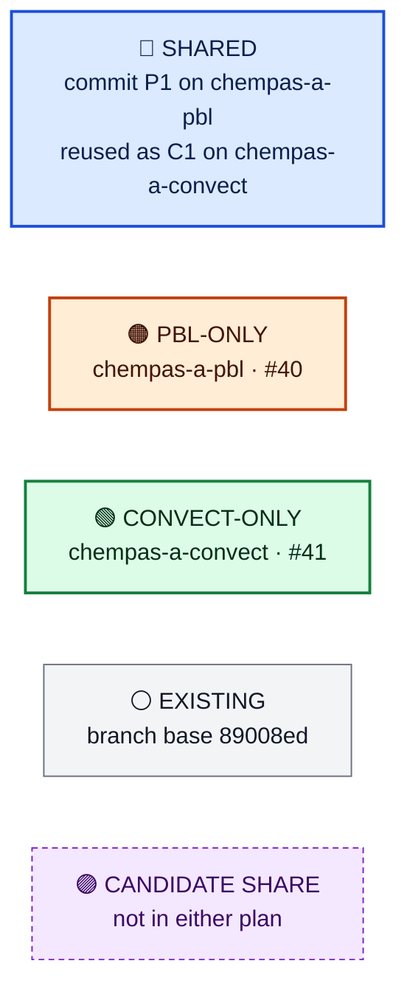
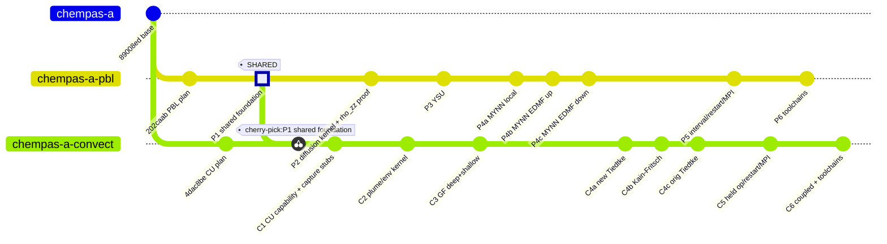
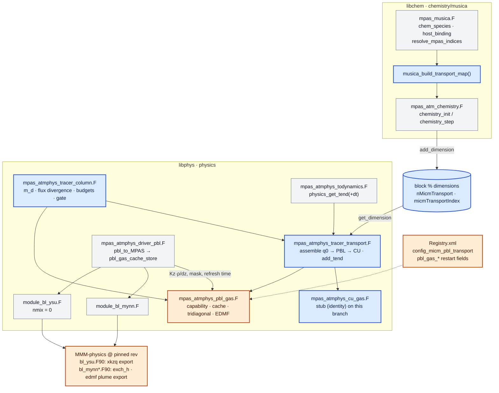
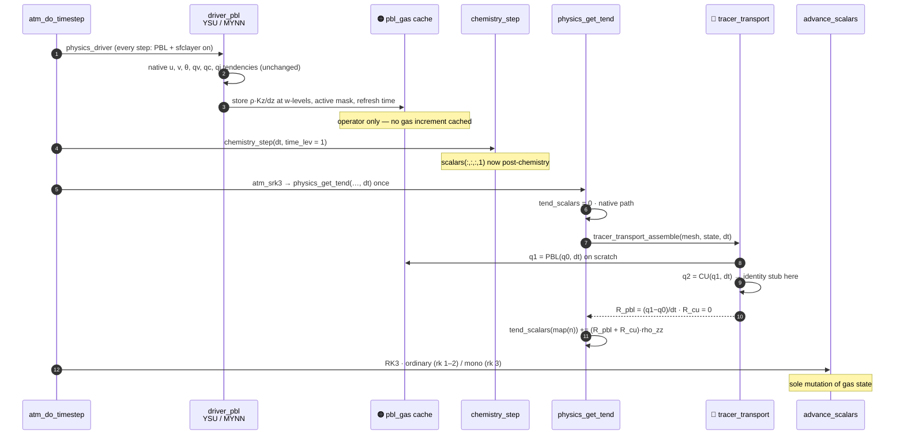
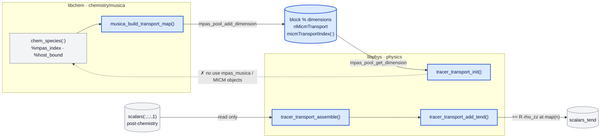
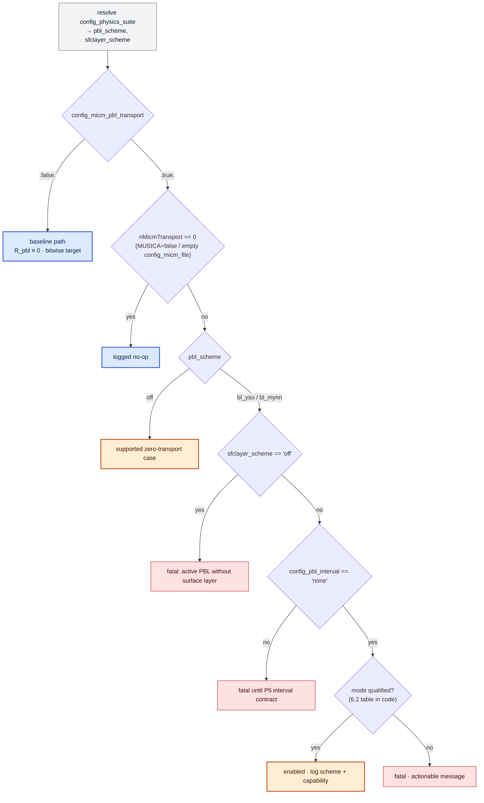
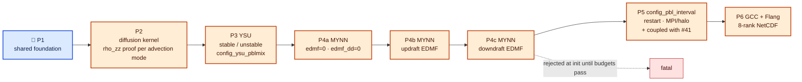
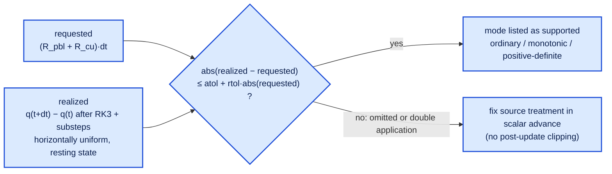

# PBL transport of MICM tracers — code & diagrams

[Plan](pbl-transport.md) · branch `chempas-a-pbl` · [CheMPAS-A #40](https://github.com/NCAR/CheMPAS-A/issues/40) · companion: [convective-transport-code.md](https://github.com/NCAR/CheMPAS-A/blob/chempas-a-convect/docs/plans/convective-transport-code.md)

## 1 · Legend



## 2 · Commit graph 🔵 (identical in both files)



## 3 · Module map (chempas-a-pbl)



## 4 · One model step (chempas-a-pbl)



## 5 · 🔵 SHARED foundation — commit P1 → reused as C1

> Every block in §5 is byte-identical in `pbl-transport-code.md` and `convective-transport-code.md`.

### 5.1 🔵 Shared file layout

```text
src/core_atmosphere/
├── chemistry/musica/
│   ├── mpas_musica.F                     🔵 + musica_build_transport_map()
│   └── mpas_atm_chemistry.F              🔵 chemistry_init: publish map to block % dimensions
├── physics/
│   ├── mpas_atmphys_tracer_column.F      🔵 NEW  units, dry mass, flux divergence, budgets, capability gate, cache meta
│   ├── mpas_atmphys_tracer_transport.F   🔵 NEW  map, buffers, assemble (PBL→CU), add_tend, lifecycle
│   ├── mpas_atmphys_pbl_gas.F            🔵 NEW  stub   ──► 🟠 body replaced on chempas-a-pbl
│   ├── mpas_atmphys_cu_gas.F             🔵 NEW  stub   ──► 🟢 body replaced on chempas-a-convect
│   ├── mpas_atmphys_todynamics.F         🔵 physics_get_tend(+dt): call assemble + add_tend
│   └── Makefile                          🔵 objects + dependencies
├── dynamics/mpas_atm_time_integration.F  🔵 atm_srk3: pass dt to physics_get_tend
└── mpas_atm_core.F                       🔵 init after chemistry_init, finalize
testing/chemistry_transport/              🔵 shared fixture/checker layout (§7)
```

### 5.2 🔵 Runtime species map — chemistry side

```fortran
! 🔵 SHARED · P1 — src/core_atmosphere/chemistry/musica/mpas_musica.F  (proposed)
    !------------------------------------------------------------------------
    !  subroutine musica_build_transport_map
    !
    !> \brief Compact list of MPAS scalar indices for independently transported MICM gases
    !------------------------------------------------------------------------
    subroutine musica_build_transport_map(num_scalars, native_index, transport_to_scalar, &
                                          error_code, error_message)

        use mpas_log, only: mpas_log_write

        integer, intent(in)  :: num_scalars
        integer, intent(in)  :: native_index(:)        ! index_qv, index_qc, ... (0 = absent)
        integer, allocatable, intent(out) :: transport_to_scalar(:)
        integer, intent(out) :: error_code
        character(len=:), allocatable, intent(out) :: error_message

        integer :: i_sp, n, idx
        logical, allocatable :: claimed(:)

        error_code = 0
        error_message = ''
        allocate(transport_to_scalar(n_chem_species))
        allocate(claimed(num_scalars))
        claimed(:) = .false.
        n = 0

        do i_sp = 1, n_chem_species
            idx = chem_species(i_sp)%mpas_index

            ! H2O -> qv, and O2/N2 anchored on qv, are not independent gases
            if (chem_species(i_sp)%host_bound .or. .not. chem_species(i_sp)%write_back) then
                call mpas_log_write('[MUSICA] transport: exclude ' // trim(chem_species(i_sp)%micm_name) // &
                                    ' (host-bound to ' // trim(chem_species(i_sp)%mpas_name) // ')')
                cycle
            end if

            if (idx < 1 .or. idx > num_scalars) then
                error_code = 1
                error_message = '[MUSICA] transport: scalar index out of range for ' // &
                                trim(chem_species(i_sp)%mpas_name)
                return
            end if
            if (any(native_index == idx)) then
                error_code = 1
                error_message = '[MUSICA] transport: ' // trim(chem_species(i_sp)%mpas_name) // &
                                ' collides with a native MPAS scalar'
                return
            end if
            if (claimed(idx)) then
                error_code = 1
                error_message = '[MUSICA] transport: duplicate scalar index for ' // &
                                trim(chem_species(i_sp)%mpas_name)
                return
            end if

            ! no filtering by name, order, contiguity, initial value, or lifetime
            claimed(idx) = .true.
            n = n + 1
            transport_to_scalar(n) = idx
            call mpas_log_write('[MUSICA] transport: ' // trim(chem_species(i_sp)%micm_name) // &
                                ' -> scalars($i)', intArgs=[idx])
        end do

        transport_to_scalar = transport_to_scalar(1:n)   ! n == 0 is a valid no-op

    end subroutine musica_build_transport_map
```

```fortran
! 🔵 SHARED · P1 — src/core_atmosphere/chemistry/musica/mpas_atm_chemistry.F :: chemistry_init
        ! Resolve MPAS tracer indices for all chemistry species
        nullify(statePool)
        call mpas_pool_get_subpool(structs, 'state', statePool)
        if (associated(statePool)) then
            call resolve_mpas_indices(statePool, error_code, error_message)
            if (error_code /= 0) then
                call chem_fatal(error_message)
            end if

            ! >>> new: block-owned transport map, consumed by physics without importing mpas_musica
            if (associated(blocklist % next)) then
                call chem_fatal('[MUSICA] transport map requires one block per rank')
            end if
            call musica_build_transport_map(num_scalars, native_scalar_indices(statePool), &
                                            transport_to_scalar, error_code, error_message)
            if (error_code /= 0) then
                call chem_fatal(error_message)
            end if
            call mpas_pool_add_dimension(blocklist % dimensions, 'nMicmTransport', size(transport_to_scalar))
            call mpas_pool_add_dimension(blocklist % dimensions, 'micmTransportIndex', transport_to_scalar)
            ! <<<
```

### 5.3 🔵 Column units, dry mass, flux divergence, budgets

```text
🔵 SHARED · P1 — closed column, MPAS k = 1 at the ground

            F(nz+1) = 0                 ← model top: closed
  ┌───────────────────────────┐
  │ layer nz   m_d(nz) q(nz)  │
  ├────────── F(nz) ──────────┤         ↑ upward-positive  [kg species m-2 s-1]
  │            ...            │
  ├────────── F(k+1) ─────────┤  = F(k+1/2)
  │ layer k    m_d(k)  q(k)   │  m_d(k)·R(k) = F(k) − F(k+1)
  ├────────── F(k) ───────────┤  = F(k−1/2)
  │            ...            │
  │ layer 1    m_d(1)  q(1)   │
  └───────────────────────────┘
            F(1) = 0                    ← ground: closed (no emission/deposition in qualification)

  q   = kg species / kg dry air          R = dq/dt  [s-1]
  m_d = zz·rho_zz·dz = rho_dry·dz        ≠ rho_p·dz,  rho_p = zz·rho_zz·(1+qv)
  domain mass = Σ_owned areaCell · Σ_k m_d·q
```

```fortran
! 🔵 SHARED · P1 — src/core_atmosphere/physics/mpas_atmphys_tracer_column.F  (new)
 module mpas_atmphys_tracer_column
 use mpas_kind_types,only: RKIND,StrKIND
 use mpas_atmphys_utilities,only: physics_error_fatal
 use mpas_log,only: mpas_log_write

 implicit none
 private
 public:: column_dry_mass,column_flux_divergence,domain_species_mass, &
          transport_budget_t,                                         &
          tracer_transport_check_capability,                          &
          transport_cache_meta_t,transport_cache_validate

 type transport_budget_t
    real(kind=RKIND):: mass_before,mass_after   ! [kg m-2] column, or [kg] domain
    real(kind=RKIND):: boundary_flux            ! [kg m-2 s-1], 0 for closed columns
    real(kind=RKIND):: residual                 ! max relative residual this step
    real(kind=RKIND):: qmin,qmax
    integer:: active_columns
 end type transport_budget_t

 contains

!=================================================================================================================
 pure function column_dry_mass(zz,rho_zz,zgrid) result(m_d)
!=================================================================================================================
!rho_dry*dz [kg m-2]; deliberately NOT the moist physics density rho_p.
 real(kind=RKIND),intent(in):: zz(:),rho_zz(:),zgrid(:)     ! zgrid has size(zz)+1 w-levels
 real(kind=RKIND):: m_d(size(zz))
 integer:: k
 do k = 1, size(zz)
    m_d(k) = zz(k)*rho_zz(k)*(zgrid(k+1)-zgrid(k))
 enddo
 end function column_dry_mass

!=================================================================================================================
 pure function column_flux_divergence(m_d,F) result(R)
!=================================================================================================================
!F(k) is the upward-positive flux through interface k-1/2; F(1) = F(nz+1) = 0 for a closed column.
 real(kind=RKIND),intent(in):: m_d(:),F(:)
 real(kind=RKIND):: R(size(m_d))
 integer:: k
 do k = 1, size(m_d)
    R(k) = (F(k) - F(k+1))/m_d(k)
 enddo
 end function column_flux_divergence

!=================================================================================================================
 real(kind=RKIND) function domain_species_mass(dminfo,nCellsSolve,areaCell,m_d,q)
!=================================================================================================================
!owned cells only: halo cells are never summed into budgets.
 use mpas_derived_types,only: dm_info
 use mpas_dmpar,only: mpas_dmpar_sum_real
 type(dm_info),intent(in):: dminfo
 integer,intent(in):: nCellsSolve
 real(kind=RKIND),intent(in):: areaCell(:),m_d(:,:),q(:,:)     ! (nVertLevels,nCells)
 real(kind=RKIND):: local
 integer:: iCell
 local = 0._RKIND
 do iCell = 1, nCellsSolve
    local = local + areaCell(iCell)*sum(m_d(:,iCell)*q(:,iCell))
 enddo
 call mpas_dmpar_sum_real(dminfo,local,domain_species_mass)
 end function domain_species_mass
```

### 5.4 🔵 Capability gate and held-operator cache metadata (framework only)

```fortran
! 🔵 SHARED · P1 — mpas_atmphys_tracer_column.F (continued)
!=================================================================================================================
 subroutine tracer_transport_check_capability(process,enabled,scheme,supported,reason)
!=================================================================================================================
!scheme-specific support tables live in mpas_atmphys_pbl_gas.F / mpas_atmphys_cu_gas.F.
 character(len=*),intent(in):: process,scheme,reason
 logical,intent(in):: enabled,supported

 call mpas_log_write('[transport] '//trim(process)//': resolved scheme = '//trim(scheme)// &
                     ', enabled = $l, supported = $l',logicArgs=(/enabled,supported/))
 if(enabled .and. .not.supported) &
    call physics_error_fatal('[transport] MICM gas '//trim(process)//' transport is not supported with '// &
                             trim(scheme)//': '//trim(reason))
 end subroutine tracer_transport_check_capability

 type transport_cache_meta_t
    character(len=StrKIND):: process          ! 'PBL' | 'convection'
    character(len=StrKIND):: signature        ! scheme // closure // interval // nVertLevels
    real(kind=RKIND):: refresh_time           ! [s] last meteorological refresh
    real(kind=RKIND):: valid_until            ! [s] next alarm, or KF nca expiry
 end type transport_cache_meta_t

!=================================================================================================================
 subroutine transport_cache_validate(meta,expected_signature,restart_has_cache,enabled)
!=================================================================================================================
!held operators are restarted; per-step gas tendencies are reconstructed, never replayed.
 type(transport_cache_meta_t),intent(in):: meta
 character(len=*),intent(in):: expected_signature
 logical,intent(in):: restart_has_cache,enabled

 if(.not.enabled) return
 if(.not.restart_has_cache) &
    call physics_error_fatal('[transport] '//trim(meta%process)// &
                             ' gas transport is enabled but the restart file has no held-operator cache')
 if(trim(meta%signature) /= trim(expected_signature)) &
    call physics_error_fatal('[transport] '//trim(meta%process)//' restart cache signature mismatch: '// &
                             trim(meta%signature)//' /= '//trim(expected_signature))
 end subroutine transport_cache_validate

 end module mpas_atmphys_tracer_column
```

### 5.5 🔵 Physics helper — map, buffers, deterministic PBL → CU assembly

```fortran
! 🔵 SHARED · P1 — src/core_atmosphere/physics/mpas_atmphys_tracer_transport.F  (new)
 module mpas_atmphys_tracer_transport
 use mpas_kind_types,only: RKIND
 use mpas_derived_types,only: mpas_pool_type,block_type
 use mpas_pool_routines
 use mpas_atmphys_tracer_column
 use mpas_atmphys_pbl_gas,only: pbl_gas_init,pbl_gas_active,pbl_gas_apply,pbl_gas_finalize  ! 🟠 body on pbl
 use mpas_atmphys_cu_gas ,only: cu_gas_init ,cu_gas_active ,cu_gas_apply ,cu_gas_finalize   ! 🟢 body on convect

 implicit none
 private
 public:: tracer_transport_init,tracer_transport_assemble,tracer_transport_add_tend, &
          tracer_transport_finalize

 integer,save:: nTransport  = 0
 integer,save:: nVertLevels = 0
 integer,save:: nCellsSolve = 0
 integer,dimension(:),allocatable,save:: transport_to_scalar      ! (nTransport)

 real(kind=RKIND),dimension(:,:,:),allocatable,save:: r_pbl        ! (nTransport,nVertLevels,nCellsSolve) [s-1]
 real(kind=RKIND),dimension(:,:,:),allocatable,save:: r_cu         ! (nTransport,nVertLevels,nCellsSolve) [s-1]
 type(transport_budget_t),dimension(:),allocatable,save:: bud_pbl,bud_cu   ! (nTransport)

 contains

!=================================================================================================================
 subroutine tracer_transport_init(block)
!=================================================================================================================
 type(block_type),intent(inout):: block
 integer,pointer:: n_ptr,nVertLevels_ptr,nCellsSolve_ptr
 integer,dimension(:),pointer:: idx_ptr

 nullify(n_ptr,idx_ptr)
 call mpas_pool_get_dimension(block%dimensions,'nMicmTransport'    ,n_ptr  )   ! absent: MUSICA=false
 call mpas_pool_get_dimension(block%dimensions,'micmTransportIndex',idx_ptr)   ! or empty config_micm_file
 call mpas_pool_get_dimension(block%dimensions,'nVertLevels'       ,nVertLevels_ptr)
 call mpas_pool_get_dimension(block%dimensions,'nCellsSolve'       ,nCellsSolve_ptr)

 nTransport  = 0
 if(associated(n_ptr)) nTransport = n_ptr
 nVertLevels = nVertLevels_ptr
 nCellsSolve = nCellsSolve_ptr

 allocate(transport_to_scalar(nTransport))
 if(nTransport > 0) transport_to_scalar(:) = idx_ptr(1:nTransport)

!allocated once, outside threaded loops:
 allocate(r_pbl(nTransport,nVertLevels,nCellsSolve))
 allocate(r_cu (nTransport,nVertLevels,nCellsSolve))
 allocate(bud_pbl(nTransport),bud_cu(nTransport))
 r_pbl(:,:,:) = 0._RKIND
 r_cu (:,:,:) = 0._RKIND

 call pbl_gas_init(block%configs)
 call cu_gas_init (block%configs)
 end subroutine tracer_transport_init

!=================================================================================================================
 subroutine tracer_transport_assemble(mesh,state,dt)
!=================================================================================================================
!once per model step, from physics_get_tend, after chemistry_step updated scalars(:,:,:,1).
!q1 = PBL(q0,dt); q2 = CU(q1,dt) on scratch columns. The prognostic state is never written here:
!the normal scalar advance is the only owner of gas state mutation.
 type(mpas_pool_type),intent(in):: mesh,state
 real(kind=RKIND),intent(in):: dt                                ! actual model dt, carried explicitly

 real(kind=RKIND),dimension(:,:,:),pointer:: scalars
 real(kind=RKIND),dimension(:,:),pointer:: zz,rho_zz,zgrid
 real(kind=RKIND),dimension(nTransport,nVertLevels):: q0,q1,q2  ! thread-private column scratch
 real(kind=RKIND),dimension(nVertLevels):: m_d
 integer:: iCell,k,n

 r_pbl(:,:,:) = 0._RKIND                                         ! inactive columns stay exactly zero
 r_cu (:,:,:) = 0._RKIND
 if(nTransport == 0) return

 call mpas_pool_get_array(state,'scalars',scalars,1)             ! post-chemistry, authoritative
 call mpas_pool_get_array(state,'rho_zz' ,rho_zz ,1)             ! TODO(P2): prove vs. 'mass' = rho_zz(:,:,2)
 call mpas_pool_get_array(mesh ,'zz'     ,zz    )
 call mpas_pool_get_array(mesh ,'zgrid'  ,zgrid )

!$OMP PARALLEL DO PRIVATE(k,n,q0,q1,q2,m_d)
 do iCell = 1, nCellsSolve                                       ! owned columns only, all host levels
    m_d(:) = column_dry_mass(zz(:,iCell),rho_zz(:,iCell),zgrid(:,iCell))
    do k = 1, nVertLevels
    do n = 1, nTransport
       q0(n,k) = scalars(transport_to_scalar(n),k,iCell)
    enddo
    enddo

    q1 = q0
    if(pbl_gas_active(iCell)) call pbl_gas_apply(iCell,dt,m_d,q1)
    q2 = q1
    if(cu_gas_active(iCell))  call cu_gas_apply (iCell,dt,m_d,q2)

    r_pbl(:,:,iCell) = (q1 - q0)/dt
    r_cu (:,:,iCell) = (q2 - q1)/dt
    call record_column_budget(m_d,q0,q1,q2)                      ! thread-private partials, reduced after loop
 enddo
!$OMP END PARALLEL DO
 end subroutine tracer_transport_assemble

!=================================================================================================================
 subroutine record_column_budget(m_d,q0,q1,q2)
!=================================================================================================================
!closed column: every species' dry-air mass is unchanged by PBL and by CU separately.
 real(kind=RKIND),intent(in):: m_d(:),q0(:,:),q1(:,:),q2(:,:)
 real(kind=RKIND):: mass0,mass1,mass2,norm
 integer:: n

 do n = 1, nTransport
    mass0 = sum(m_d*q0(n,:))
    mass1 = sum(m_d*q1(n,:))
    mass2 = sum(m_d*q2(n,:))
    norm  = max(mass0,sum(m_d)*1.e-30_RKIND)
    bud_pbl(n)%residual = max(bud_pbl(n)%residual,abs(mass1-mass0)/norm)   ! gate: <= 1e-12 per call
    bud_cu (n)%residual = max(bud_cu (n)%residual,abs(mass2-mass1)/norm)
    bud_pbl(n)%qmin = min(bud_pbl(n)%qmin,minval(q1(n,:)))
    bud_cu (n)%qmin = min(bud_cu (n)%qmin,minval(q2(n,:)))
    bud_pbl(n)%qmax = max(bud_pbl(n)%qmax,maxval(q1(n,:)))
    bud_cu (n)%qmax = max(bud_cu (n)%qmax,maxval(q2(n,:)))
 enddo
 end subroutine record_column_budget
```

### 5.6 🔵 Single mapped tendency loop

```fortran
! ⚪ EXISTING — src/core_atmosphere/physics/mpas_atmphys_todynamics.F:399  (fixed native indices only)
       tend_scalars(index_qv,k,i) = tend_scalars(index_qv,k,i) + rqvblten(k,i)*mass(k,i)
       tend_scalars(index_qc,k,i) = tend_scalars(index_qc,k,i) + rqcblten(k,i)*mass(k,i)
       tend_scalars(index_qi,k,i) = tend_scalars(index_qi,k,i) + rqiblten(k,i)*mass(k,i)
```

```fortran
! 🔵 SHARED · P1 — mpas_atmphys_tracer_transport.F (continued)
!=================================================================================================================
 subroutine tracer_transport_add_tend(mass,tend_scalars)
!=================================================================================================================
!PBL + convection gas tendencies, added exactly once per mapped scalar, after tend_scalars was cleared.
!Native moisture keeps its existing path; no second qv tendency is possible (qv is never in the map).
 real(kind=RKIND),intent(in),dimension(:,:):: mass               ! rho_zz, time level 2, as native moisture
 real(kind=RKIND),intent(inout),dimension(:,:,:):: tend_scalars
 integer:: i,k,n

 do i = 1, nCellsSolve
 do k = 1, nVertLevels
 do n = 1, nTransport
    tend_scalars(transport_to_scalar(n),k,i) = tend_scalars(transport_to_scalar(n),k,i) &
                                             + (r_pbl(n,k,i) + r_cu(n,k,i))*mass(k,i)
 enddo
 enddo
 enddo
 end subroutine tracer_transport_add_tend
```

```fortran
! 🔵 SHARED · P1 — src/core_atmosphere/physics/mpas_atmphys_todynamics.F :: physics_get_tend
 subroutine physics_get_tend(block,mesh,state,diag,tend,tend_physics,configs,rk_step,dynamics_substep, &
                             tend_ru_physics,tend_rtheta_physics,tend_rho_physics,exchange_halo_group, &
                             dt)                                                    ! + dt
 use mpas_atmphys_tracer_transport,only: tracer_transport_assemble,tracer_transport_add_tend
 ...
 real(kind=RKIND),intent(in):: dt
 ...
 tend_scalars(:,:,:)      = 0._RKIND                                               ! existing clear
 ...
 call physics_get_tend_work( ... )                                                 ! existing native path
 call tracer_transport_assemble(mesh,state,dt)                                     ! new
 call tracer_transport_add_tend(mass,tend_scalars)                                 ! new
```

```fortran
! 🔵 SHARED · P1 — src/core_atmosphere/dynamics/mpas_atm_time_integration.F :: atm_srk3
      rk_step = 1
      dynamics_substep = 1
      call physics_get_tend( block, mesh, state, diag, tend, tend_physics, &
                             block % configs, rk_step, dynamics_substep, &
                             tend_ru_physics, tend_rtheta_physics, tend_rho_physics, &
                             exchange_halo_group, dt )
```

### 5.7 🔵 Stub process modules (each branch replaces only its own)

```fortran
! 🔵 SHARED · P1 — src/core_atmosphere/physics/mpas_atmphys_pbl_gas.F  (stub → 🟠 replaced on chempas-a-pbl)
 module mpas_atmphys_pbl_gas
 use mpas_kind_types,only: RKIND
 use mpas_derived_types,only: mpas_pool_type
 implicit none
 private
 public:: pbl_gas_init,pbl_gas_active,pbl_gas_apply,pbl_gas_finalize

 contains

 subroutine pbl_gas_init(configs)
 type(mpas_pool_type),intent(in):: configs
 end subroutine pbl_gas_init

 logical function pbl_gas_active(iCell)
 integer,intent(in):: iCell
 pbl_gas_active = .false.
 end function pbl_gas_active

 subroutine pbl_gas_apply(iCell,dt,m_d,q)
 integer,intent(in):: iCell
 real(kind=RKIND),intent(in):: dt,m_d(:)
 real(kind=RKIND),intent(inout):: q(:,:)                ! (nTransport,nVertLevels): identity
 end subroutine pbl_gas_apply

 subroutine pbl_gas_finalize
 end subroutine pbl_gas_finalize

 end module mpas_atmphys_pbl_gas
```

```fortran
! 🔵 SHARED · P1 — src/core_atmosphere/physics/mpas_atmphys_cu_gas.F  (stub → 🟢 replaced on chempas-a-convect)
 module mpas_atmphys_cu_gas
 use mpas_kind_types,only: RKIND
 use mpas_derived_types,only: mpas_pool_type
 implicit none
 private
 public:: cu_gas_init,cu_gas_active,cu_gas_apply,cu_gas_finalize

 contains

 subroutine cu_gas_init(configs)
 type(mpas_pool_type),intent(in):: configs
 end subroutine cu_gas_init

 logical function cu_gas_active(iCell)
 integer,intent(in):: iCell
 cu_gas_active = .false.
 end function cu_gas_active

 subroutine cu_gas_apply(iCell,dt,m_d,q)
 integer,intent(in):: iCell
 real(kind=RKIND),intent(in):: dt,m_d(:)
 real(kind=RKIND),intent(inout):: q(:,:)                ! (nTransport,nVertLevels): identity
 end subroutine cu_gas_apply

 subroutine cu_gas_finalize
 end subroutine cu_gas_finalize

 end module mpas_atmphys_cu_gas
```

### 5.8 🔵 Lifecycle

```fortran
! 🔵 SHARED · P1 — src/core_atmosphere/mpas_atm_core.F :: atm_core_init
#ifdef DO_CHEMISTRY
      call chemistry_init(domain % blocklist % configs, domain % blocklist % dimensions, &
                         domain % blocklist % structs, domain % dminfo, domain % blocklist)
      ...
#endif
#ifdef DO_PHYSICS
      call tracer_transport_init(domain % blocklist)    ! after chemistry_init; empty map without MUSICA
#endif
```

```fortran
! 🔵 SHARED · P1 — mpas_atmphys_tracer_transport.F (continued)
!=================================================================================================================
 subroutine tracer_transport_finalize
!=================================================================================================================
 if(allocated(transport_to_scalar)) deallocate(transport_to_scalar)
 if(allocated(r_pbl)  ) deallocate(r_pbl  )
 if(allocated(r_cu)   ) deallocate(r_cu   )
 if(allocated(bud_pbl)) deallocate(bud_pbl)
 if(allocated(bud_cu) ) deallocate(bud_cu )
 call pbl_gas_finalize
 call cu_gas_finalize
 nTransport = 0                                          ! repeated initialization starts clean
 end subroutine tracer_transport_finalize

 end module mpas_atmphys_tracer_transport
```

### 5.9 🔵 Build dependencies

```makefile
# 🔵 SHARED · P1 — src/core_atmosphere/physics/Makefile
OBJS = \
	...
	mpas_atmphys_tracer_column.o       \
	mpas_atmphys_pbl_gas.o             \
	mpas_atmphys_cu_gas.o              \
	mpas_atmphys_tracer_transport.o    \
	mpas_atmphys_todynamics.o          \
	...

mpas_atmphys_tracer_column.o: \
	mpas_atmphys_utilities.o

mpas_atmphys_pbl_gas.o: \
	mpas_atmphys_tracer_column.o

mpas_atmphys_cu_gas.o: \
	mpas_atmphys_tracer_column.o

mpas_atmphys_tracer_transport.o: \
	mpas_atmphys_tracer_column.o \
	mpas_atmphys_pbl_gas.o \
	mpas_atmphys_cu_gas.o

mpas_atmphys_todynamics.o: \
	mpas_atmphys_constants.o \
	mpas_atmphys_tracer_transport.o \
	mpas_atmphys_vars.o

# libphys never depends on libchem: the map crosses only through block % dimensions
```

### 5.10 🔵 Ownership boundary



## 6 · 🟠 PBL-ONLY code (chempas-a-pbl)

### 6.1 🟠 Namelist option and restart cache

```xml
<!-- 🟠 PBL-ONLY · after P1 — Registry.xml, nml_record "physics"
     (outside #ifdef MPAS_USE_MUSICA so libphys can read it in every build) -->
                <nml_option name="config_micm_pbl_transport" type="logical" default_value="false" in_defaults="false"
                     units="-"
                     description="Vertically mix every independently transported MICM gas with the active PBL scheme"
                     possible_values=".true. or .false."/>
```

```xml
<!-- 🟠 PBL-ONLY · P5 — Registry.xml, var_struct "diag_physics": held PBL operator (restart) -->
                <var name="pbl_gas_kzrho" type="real" dimensions="nVertLevelsP1 nCells Time"
                     units="kg m^{-2} s^{-1}"
                     description="rho_dry*Kz/dz at w-levels used for MICM gas PBL mixing; 0 at ground and top"
                     packages="micm_pbl_transport"/>
                <var name="pbl_gas_mask" type="integer" dimensions="nCells Time" units="-"
                     description="1 where the PBL gas operator is active"
                     packages="micm_pbl_transport"/>
                <var name="pbl_gas_refresh_time" type="real" dimensions="Time" units="s"
                     description="model time of the last PBL operator refresh"
                     packages="micm_pbl_transport"/>
```

### 6.2 🟠 Initialization gate



```fortran
! 🟠 PBL-ONLY — src/core_atmosphere/physics/mpas_atmphys_pbl_gas.F :: pbl_gas_init  (replaces 🔵 stub body)
 subroutine pbl_gas_init(configs)
 use mpas_atmphys_tracer_column,only: tracer_transport_check_capability
 type(mpas_pool_type),intent(in):: configs

 logical,pointer:: enabled,ysu_pblmix
 character(len=StrKIND),pointer:: pbl_scheme,sfclayer_scheme,pbl_interval
 integer,pointer:: mynn_edmf,mynn_edmf_dd
 logical:: supported
 character(len=StrKIND):: reason
 logical,parameter:: edmf_up_qualified = .false.                           ! flipped in the P4b commit

 call mpas_pool_get_config(configs,'config_micm_pbl_transport',enabled        )
 call mpas_pool_get_config(configs,'config_pbl_scheme'        ,pbl_scheme     )
 call mpas_pool_get_config(configs,'config_sfclayer_scheme'   ,sfclayer_scheme)
 call mpas_pool_get_config(configs,'config_pbl_interval'      ,pbl_interval   )
 call mpas_pool_get_config(configs,'config_ysu_pblmix'        ,ysu_pblmix     )
 call mpas_pool_get_config(configs,'config_mynn_edmf'         ,mynn_edmf      )
 call mpas_pool_get_config(configs,'config_mynn_edmf_dd'      ,mynn_edmf_dd   )

 supported = .false.
 reason    = ''
 pbl_select: select case(trim(pbl_scheme))
    case('off')
       supported = .true.
    case('bl_ysu')                                                          ! P3
       supported = .true.                                                   ! normal + config_ysu_pblmix
    case('bl_mynn')
       if(mynn_edmf == 0 .and. mynn_edmf_dd == 0) supported = .true.       ! P4a
       if(mynn_edmf == 1 .and. mynn_edmf_dd == 0) supported = edmf_up_qualified  ! P4b
       if(mynn_edmf_dd == 1) reason = 'MYNN downdraft EDMF gas budgets not qualified (P4c)'
    case default
       reason = 'no MICM gas adapter for this PBL scheme'
 end select pbl_select

 if(trim(pbl_scheme) /= 'off' .and. trim(sfclayer_scheme) == 'off') then
    supported = .false.
    reason    = 'active PBL requires a surface layer scheme'
 endif
 if(trim(pbl_interval) /= 'none') then
    supported = .false.
    reason    = 'config_pbl_interval must be ''none'' until the P5 interval contract'
 endif

 call tracer_transport_check_capability('PBL',enabled,pbl_scheme,supported,reason)
 pbl_gas_enabled = enabled .and. trim(pbl_scheme) /= 'off'
 end subroutine pbl_gas_init
```

### 6.3 🟠 YSU wrapper — export the scalar operator, do not mix stale gas

```fortran
! ⚪ EXISTING — src/core_atmosphere/physics/physics_wrf/module_bl_ysu.F:237
   integer,  parameter :: nmix = 0
   integer :: n

   real(kind=kind_phys),   dimension(ims:ime,kms:kme,jms:jme,nmix)::       qmix
   real(kind=kind_phys),   dimension(ims:ime,kms:kme,jms:jme,nmix):: rqmixblten
```

```fortran
! ⚪ EXISTING — src/core_atmosphere/physics/mpas_atmphys_driver_pbl.F:604  (not the YSU scalar operator)
    kzq(k,i) = kzh_p(i,k,j)
```

```fortran
! 🟠 PBL-ONLY · P3 — module_bl_ysu.F :: ysu  (wrapper)
!physics runs before chemistry: gas passed here would be stale. Keep nmix = 0 and export instead
!the moisture-matrix diffusivity (incl. YSU entrainment-layer K) that bl_ysu_run actually solved with.
      call bl_ysu_run(ux=u3d_hv,vx=v3d_hv                                      &
              ...
              ,nmix=nmix,qmix=qmix_hv                                          &
              ,qmixtnp=rqmixblten_hv                                           &
              ...
              ,xkzq_out=xkzq_hv                                                & ! 🟠 MMM export (pinned rev)
              ,errmsg=errmsg,errflg=errflg)

      do k = kts, kte
      do i = its, ite
         xkzq(i,k,j) = xkzq_hv(i,k)
      enddo
      enddo
```

```fortran
! 🟠 PBL-ONLY · P3 — external NCAR/MMM-physics bl_ysu.F90 :: bl_ysu_run  (versioned change, not an ignored-checkout edit)
   real(kind=kind_phys),dimension(its:ite,kts:kte),intent(out),optional:: xkzq_out
   ...
   ! after xkzq is final for the scalar solve (same matrix as qmix/qmixtnp)
   if(present(xkzq_out)) xkzq_out(its:ite,kts:kte) = xkzq(its:ite,kts:kte)
```

### 6.4 🟠 PBL driver — cache the operator, not an increment

```fortran
! 🟠 PBL-ONLY · P3/P4 — src/core_atmosphere/physics/mpas_atmphys_driver_pbl.F :: pbl_to_MPAS
 if(pbl_gas_enabled) then
    do i = its, ite
       pbl_gas_kzrho(kts  ,i) = 0._RKIND                                 ! ground: closed
       pbl_gas_kzrho(kte+1,i) = 0._RKIND                                 ! top: closed
       do k = kts, kte-1
          dzc = 0.5_RKIND*(dz_p(i,k,j) + dz_p(i,k+1,j))
          select case(trim(pbl_scheme))
             case('bl_ysu')
                !P3 gate: confirm xkzq(k) sits on w-level k+1 (between layers k and k+1)
                pbl_gas_kzrho(k+1,i) = rho_dry_w(i,k+1)*xkzq(i,k,j)/dzc
             case('bl_mynn')
                !P4a gate: confirm exch_h stagger and units
                pbl_gas_kzrho(k+1,i) = rho_dry_w(i,k+1)*exch_h_p(i,k+1,j)/dzc
          end select
       enddo
       pbl_gas_mask(i) = merge(1,0,any(pbl_gas_kzrho(:,i) > 0._RKIND))
    enddo
    pbl_gas_refresh_time = xtime_s
 endif
```

### 6.5 🟠 Apply hook (replaces 🔵 stub)

```fortran
! 🟠 PBL-ONLY · P2–P4 — src/core_atmosphere/physics/mpas_atmphys_pbl_gas.F
 logical function pbl_gas_active(iCell)
 integer,intent(in):: iCell
 pbl_gas_active = pbl_gas_enabled .and. pbl_gas_mask(iCell) == 1
 end function pbl_gas_active

 subroutine pbl_gas_apply(iCell,dt,m_d,q)
 integer,intent(in):: iCell
 real(kind=RKIND),intent(in):: dt                       ! model dt — NOT YSU's dt2 = 2*dt
 real(kind=RKIND),intent(in):: m_d(:)                   ! rho_dry*dz [kg m-2] (🔵 shared helper)
 real(kind=RKIND),intent(inout):: q(:,:)                ! (nTransport,nVertLevels), fresh post-chemistry

 call pbl_diffuse_column(size(m_d),size(q,1),dt,m_d,pbl_gas_kzrho(:,iCell),q)
 if(mynn_edmf_gas) call pbl_edmf_updraft_column(iCell,dt,m_d,q)          ! P4b
 end subroutine pbl_gas_apply
```

### 6.6 🟠 Closed-column implicit diffusion (one factorization, all species)

```text
🟠 PBL-ONLY · P2 — tridiagonal row k   (G(k) = pbl_gas_kzrho(k) = ρ·Kz/Δz at interface k−1/2)

   a(k)·q⁺(k−1)  +  b(k)·q⁺(k)  +  c(k)·q⁺(k+1)  =  q(k)

   a(k) = −Δt·G(k)  /m_d(k)        G(1)    = 0  → no ground flux
   c(k) = −Δt·G(k+1)/m_d(k)        G(nz+1) = 0  → no top flux
   b(k) = 1 − a(k) − c(k)          M-matrix: monotone, Σ_k m_d·q conserved to roundoff
```

```fortran
! 🟠 PBL-ONLY · P2 — src/core_atmosphere/physics/mpas_atmphys_pbl_gas.F
!=================================================================================================================
 pure subroutine pbl_diffuse_column(nz,nt,dt,m_d,G,q)
!=================================================================================================================
 integer,intent(in):: nz,nt
 real(kind=RKIND),intent(in):: dt,m_d(nz),G(nz+1)
 real(kind=RKIND),intent(inout):: q(nt,nz)

 real(kind=RKIND),dimension(nz):: a,b,c,cp
 real(kind=RKIND),dimension(nt,nz):: dp
 real(kind=RKIND):: w
 integer:: k

 do k = 1, nz
    a(k) = -dt*G(k)  /m_d(k)
    c(k) = -dt*G(k+1)/m_d(k)
    b(k) = 1._RKIND - a(k) - c(k)
 enddo

!Thomas sweep: coefficients shared by every species; no positive floor, a zero species stays zero.
 cp(1)   = c(1)/b(1)
 dp(:,1) = q(:,1)/b(1)
 do k = 2, nz
    w       = b(k) - a(k)*cp(k-1)
    cp(k)   = c(k)/w
    dp(:,k) = (q(:,k) - a(k)*dp(:,k-1))/w
 enddo
 q(:,nz) = dp(:,nz)
 do k = nz-1, 1, -1
    q(:,k) = dp(:,k) - cp(k)*q(:,k+1)
 enddo
 end subroutine pbl_diffuse_column
```

### 6.7 🟠 MYNN updraft EDMF on fresh gas 🟣 candidate share with convection plume kernel

```fortran
! 🟠 PBL-ONLY · P4b — mpas_atmphys_pbl_gas.F :: pbl_edmf_updraft_column
! 🟣 CANDIDATE SHARE (not in plan): same plume/environment algebra as 🟢 cu_plume_profiles + cu_total_flux.
!    Cached from MYNN: edmf_mu (dry-air plume mass flux on w-levels), edmf_ent (entrainment per layer).
!    Plume gas is rebuilt from the current q; edmf_a / edmf_w / exch_h alone are not the operator.
 subroutine pbl_edmf_updraft_column(iCell,dt,m_d,q)
 integer,intent(in):: iCell
 real(kind=RKIND),intent(in):: dt,m_d(:)
 real(kind=RKIND),intent(inout):: q(:,:)
 real(kind=RKIND),dimension(size(q,1),size(q,2)):: qu
 real(kind=RKIND),dimension(size(q,1),size(q,2)+1):: F
 real(kind=RKIND):: mu_in,mu_out,me,denom
 integer:: k,nz,nsub,isub

 nz = size(m_d)
 nsub = edmf_substeps(iCell,dt,m_d)                       ! outgoing-mass bound, safety ≤ 0.8
 do isub = 1, nsub
    !plume: mu(k+1)·qu(k) = mu(k)·qu(k-1) + E(k)·q(k) − D(k)·qu(k)
    qu = q                                                ! no plume above ktop
    do k = 1, edmf_ktop(iCell)
       mu_in = edmf_mu(k,iCell)
       denom = mu_in + edmf_ent(k,iCell)
       if(denom > 0._RKIND) then
          qu(:,k) = edmf_ent(k,iCell)*q(:,k)/denom
          if(k > 1) qu(:,k) = qu(:,k) + mu_in*qu(:,k-1)/denom
       else
          qu(:,k) = q(:,k)
       endif
    enddo
    !plume flux + compensating environmental subsidence (donor = layer above)
    F(:,1) = 0._RKIND
    F(:,nz+1) = 0._RKIND
    do k = 2, nz
       mu_out = edmf_mu(k,iCell)
       me     = -mu_out
       F(:,k) = mu_out*qu(:,k-1) + me*q(:,k)
    enddo
    do k = 1, nz
       q(:,k) = q(:,k) + (dt/nsub)*(F(:,k) - F(:,k+1))/m_d(k)
    enddo
 enddo
 end subroutine pbl_edmf_updraft_column
```

### 6.8 🟠 What is deliberately not reused from WRF-Chem paths

```fortran
! 🟠 PBL-ONLY — do NOT enable globally
!#define WRF_CHEM            ! module_bl_mynn.F chemistry arguments: inconsistent identifiers in this wrapper
!call mynn_mix_chem(...)     ! carries deposition velocity, prescribed top value, positive floor
!vd1 / emis / fire enhancement → none: closed column, zero-flux boundaries, no tracer floor
```

### 6.9 🟠 Scheme qualification ladder



## 7 · 🔵 SHARED verification harness

> Byte-identical in both files. Branch-specific fixtures are marked inside the tree.

### 7.1 🔵 Fixture layout

```text
testing/chemistry_transport/                     🔵 layout + checker shared (P1/P2 = C1/C2)
├── MANIFEST.md                                  🔵 URLs, sha256, revisions, compilers, build + MPI commands
├── check_budget.py                              🔵 thresholds (7.2)
├── align_by_cell_id.py                          🔵 1-rank vs 8-rank via indexToCellID
├── mechanisms/
│   ├── inert_n0.json  inert_n1.json  inert_n3.json  inert_n64.json        🔵
│   ├── inert_n3_reordered.json  noncontiguous_interleaved.json            🔵
│   ├── h2o_o2_n2_bound.json                                               🔵 exclusions
│   └── abba/  chapman_nox/                                                🔵 reactive, coupled stage
├── columns/
│   ├── diffusion_*.nc   ysu_*.nc   mynn_*.nc                              🟠
│   └── plume_2layer.nc  plume_3layer.nc  gf_*.nc  kf_*.nc  ntiedtke_*.nc  🟢
├── namelists/
│   ├── pbl_ysu_{stable,convective,topdown}/  pbl_mynn_{local,edmf,edmf_dd}/   🟠
│   ├── cu_gf_{deep,shallow,both}/  cu_kf_{trigger,hold,expiry}/  cu_ntiedtke/ 🟢
│   └── coupled_pbl_cu_{inert,abba,chapman}/                                  🔵
└── results/<run-id>/summary.json                🔵 tracked summaries; NetCDF stays in the run-data tree
```

### 7.2 🔵 Frozen double-precision thresholds

```python
# 🔵 SHARED · P1/P2 — testing/chemistry_transport/check_budget.py
import numpy as np

MASS_RESID_PER_CALL   = 1e-12    # isolated closed column, per call
MASS_RESID_1000_CALLS = 1e-10    # isolated closed column, 1,000 calls
FULL_RUN_RESID        = 1e-8     # accumulated transport budget, full integration
UNIFORM_ATOL, UNIFORM_RTOL   = 1e-20, 1e-12   # kg/kg; uniform-profile + permutation
PARALLEL_ATOL, PARALLEL_RTOL = 1e-18, 1e-10   # kg/kg; serial/8-rank, restart, short compiler


def column_mass(m_d, q):
    """m_d: (..., nz) kg m-2 dry air; q: (..., nspecies, nz) kg/kg -> (..., nspecies) kg m-2."""
    return np.sum(m_d[..., None, :] * q, axis=-1)


def relative_residual(m_d, q_before, q_after, boundary_flux=0.0, dt=0.0):
    before = column_mass(m_d, q_before)
    after = column_mass(m_d, q_after)
    norm = np.maximum(before, np.sum(m_d, axis=-1)[..., None] * 1e-30)
    absolute = np.abs(after - before - dt * boundary_flux)
    return absolute / norm, absolute          # report both


def nonnegative(q_after, q_initial):
    floor = -(1e-20 + 1e-12 * np.max(q_initial, axis=-1, keepdims=True))
    return np.all(q_after >= floor)


def zero_species_stays_zero(q_after, q_initial):
    zero_column = np.all(q_initial == 0.0, axis=-1)
    return np.all(q_after[zero_column] == 0.0)


def uniform_profile_unchanged(q_after, q_uniform):
    return np.allclose(q_after, q_uniform, atol=UNIFORM_ATOL, rtol=UNIFORM_RTOL)


def disabled_matches_baseline(fields_new, fields_base):
    return all(np.array_equal(fields_new[k], fields_base[k]) for k in fields_base)   # prefer bitwise
```

### 7.3 🔵 Realized-increment check (requested vs. applied)


